* TOC
{:toc}

## Removed Since 2.0.0
[//]: # (HTML is easier to maintain as markdown when applying changes)
<table>
    <tr>
        <td>
            

            
<a href="maps-old/Auster">Auster</a>

        </td>
        <td>
            

            
<a href="maps-old/Ennui">Ennui</a>

        </td>
    </tr>
</table>

## 1.6 maps

### Main Maps
[//]: # (HTML is easier to maintain as markdown when applying changes)
<table>
    <tr>
        <td>
            
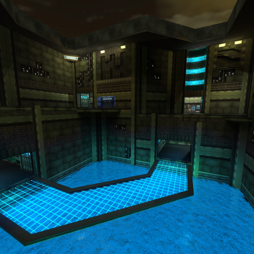

            
Abuse

        </td>
        <td>
            
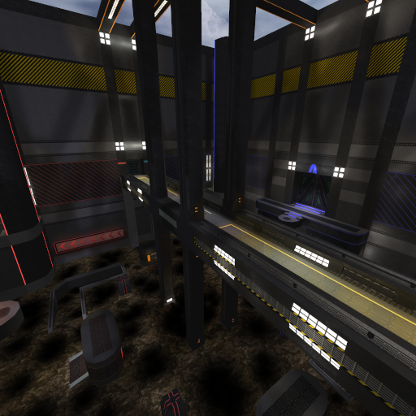

            
Battlefield

        </td>
        <td>
            

            
Conflict

        </td>
        <td>
            
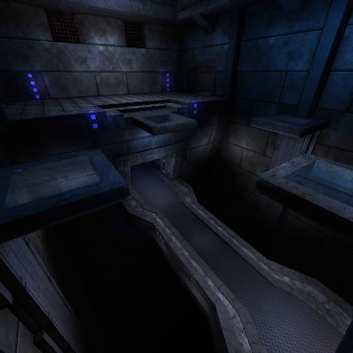

            
Darkness

        </td>
        <td>
            

            
Dropzone

        </td>
    </tr>
    <tr>
        <td>
            
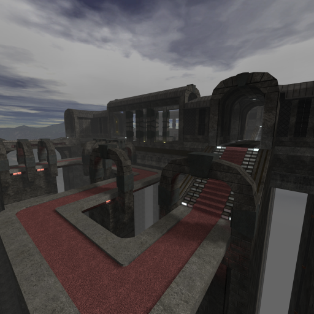

            
Enyo

        </td>
        <td>
            
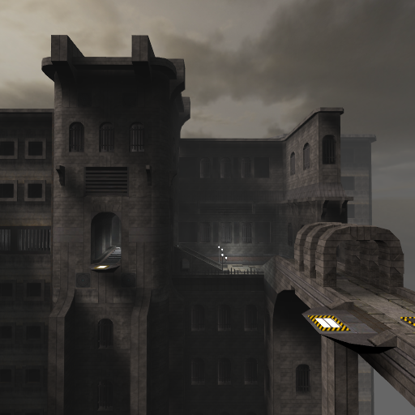

            
Ghost

        </td>
        <td>
            
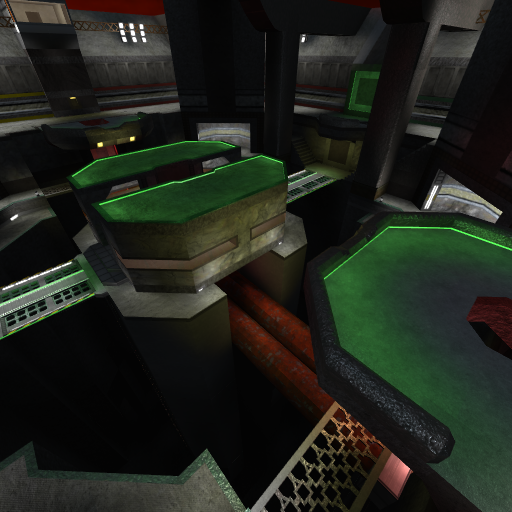

            
Keystone2k

        </td>
        <td>
            
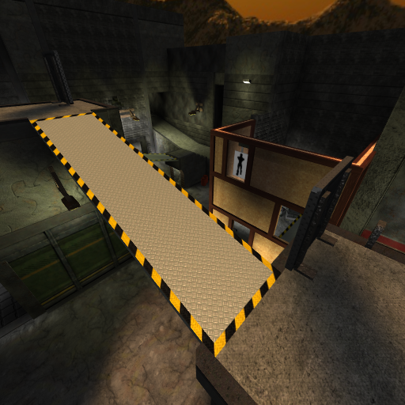

            
Livefire

        </td>
        <td>
            

            
Longestyard

        </td>
    </tr>
    <tr>
        <td>
            
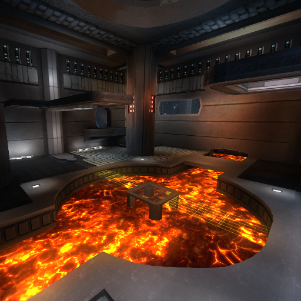

            
Nova

        </td>
        <td>
            
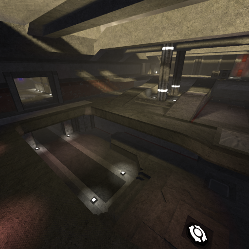

            
Panic

        </td>
        <td>
            
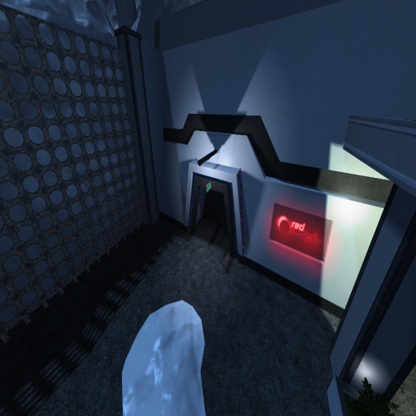

            
Polaris

        </td>
        <td>
            

            
Suspended

        </td>
        <td>
            
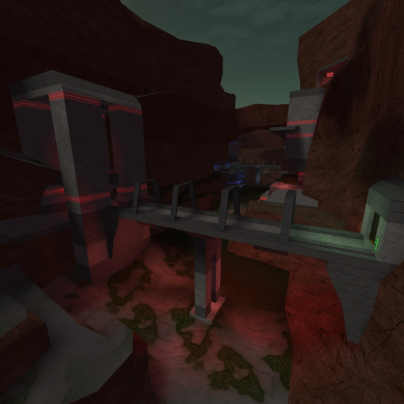

            
Tribal

        </td>
    </tr>
</table>

### Speedrun / Race maps
[//]: # (HTML is easier to maintain as markdown when applying changes)
<table>
    <tr>
        <td>
            

            
<a href="maps-old/Absorption">Absorption</a>

        </td>
        <td>
            
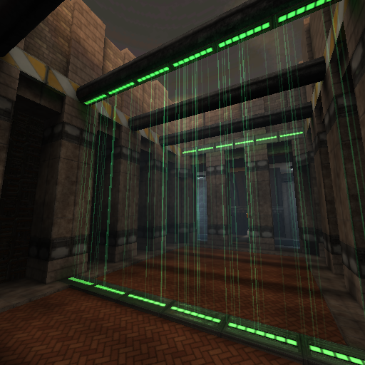

            
Decomposition

        </td>
        <td>
            
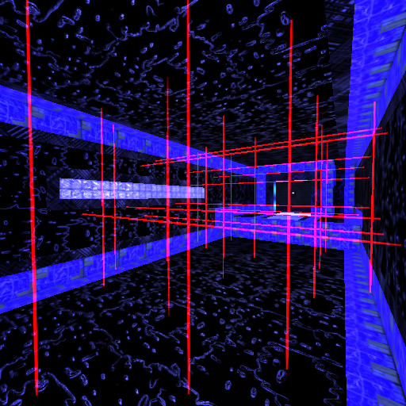

            
Escape

        </td>
        <td>
            
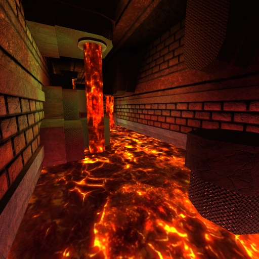

            
Hinder

        </td>
        <td>
            
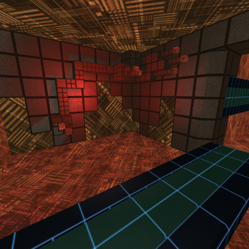

            
Purge

        </td>
    </tr>
    <tr>
        <td>
            
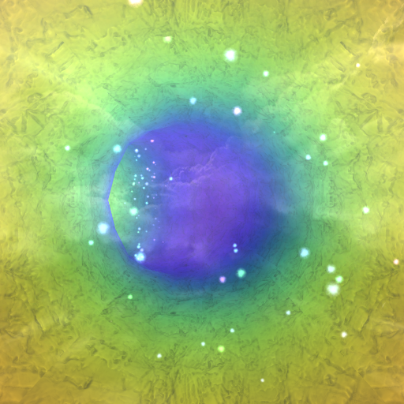

            
Relax

        </td>
        <td>
            
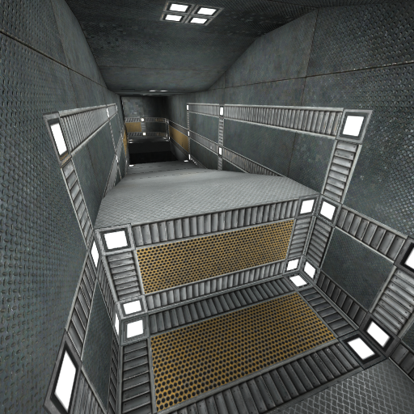

            
Testchamber

        </td>
        <td>
            

            
Wardepot

        </td>
    </tr>
</table>

### Gladiator maps
[//]: # (HTML is easier to maintain as markdown when applying changes)
<table>
    <tr>
        <td>
            

            
Abuse

        </td>
        <td>
            

            
<b>Disco</b>

        </td>
        <td>
            
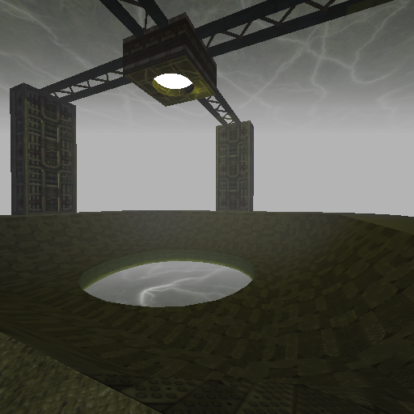

            
<b>Eternal</b>

        </td>
        <td>
            

            
Purge

        </td>
        <td>
            

            
<b>Singularity</b>

        </td>
    </tr>
    <tr>
        <td>
            

            
<b>Torus</b>

        </td>
    </tr>
</table>

**Note:** Bold maps are gladiator-only; other maps are adapted from other game modes.

### Removed in 1.5.8
[//]: # (HTML is easier to maintain as markdown when applying changes)
<table>
    <tr>
        <td>
            
<a href="maps-old/Canals">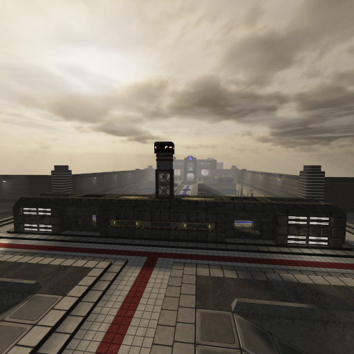</a>

            
<a href="maps-old/Canals">Canals</a>

        </td>
        <td>
            
<a href="maps-old/Colony">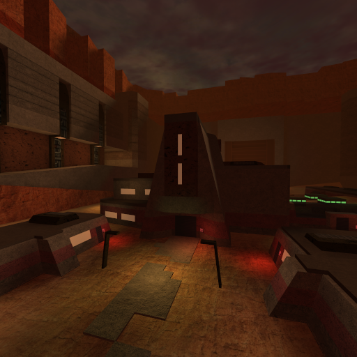</a>

            
<a href="maps-old/Colony">Colony</a>

        </td>
        <td>
            

            
Train

        </td>
    </tr>
</table>

### Removed in 1.5.6
[//]: # (HTML is easier to maintain as markdown when applying changes)
<table>
    <tr>
        <td>
            

            
<a href="maps-old/Linear">Linear</a>

        </td>
    </tr>
</table>

### Removed in 1.5.4
[//]: # (HTML is easier to maintain as markdown when applying changes)
<table>
    <tr>
        <td>
            

            
<a href="maps-old/Condensation">Condensation</a>

        </td>
        <td>
            
<a href="maps-old/Convolution">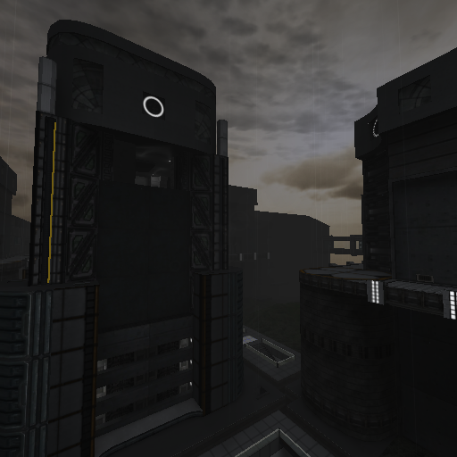</a>

            
<a href="maps-old/Convolution">Convolution</a>

        </td>
    </tr>
</table>

### Removed in 1.5.0
[//]: # (HTML is easier to maintain as markdown when applying changes)
<table>
    <tr>
        <td>
            

            
<a href="maps-old/Amplification">Amplification</a>

        </td>
        <td>
            
<a href="maps-old/Forge">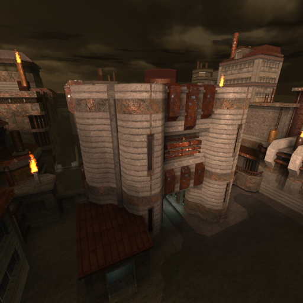</a>

            
<a href="maps-old/Forge">Forge</a>

        </td>
        <td>
            
<a href="maps-old/Foundation">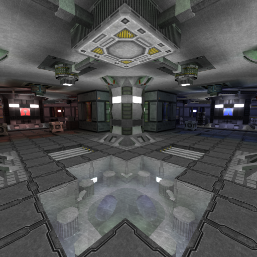</a>

            
<a href="maps-old/Foundation">Foundation</a>

        </td>
        <td>
            

            
<a href="maps-old/Fourplex">Fourplex</a>

        </td>
        <td>
            
<a href="maps-old/Hawk">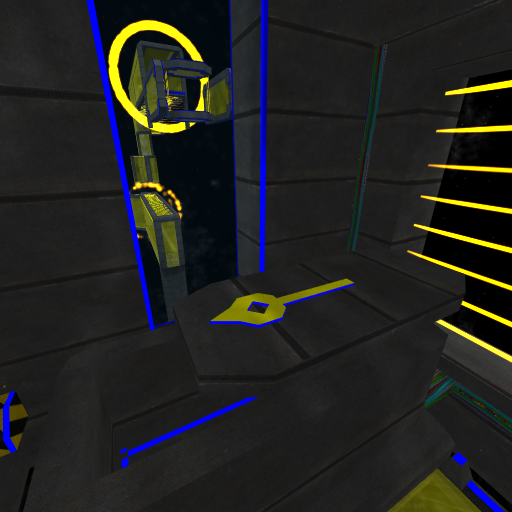</a>

            
<a href="maps-old/Hawk">Hawk</a>

        </td>
    </tr>
    <tr>
        <td>
            

            
<a href="maps-old/Starlibido">Starlibido</a>

        </td>
        <td>
            

            
<a href="maps-old/Warp">Warp</a>

        </td>
    </tr>
</table>

### Removed in 1.4.0
[//]: # (HTML is easier to maintain as markdown when applying changes)
<table>
    <tr>
        <td>
            
<a href="maps-old/Blink">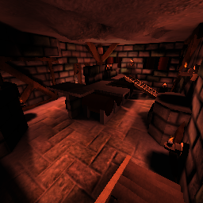</a>

            
<a href="maps-old/Blink">Blink</a>

        </td>
        <td>
            
<a href="maps-old/Dawn">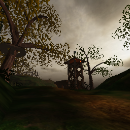</a>

            
<a href="maps-old/Dawn">Dawn</a>

        </td>
        <td>
            
<a href="maps-old/Facility">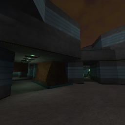</a>

            
<a href="maps-old/Facility">Facility</a>

        </td>
        <td>
            
<a href="maps-old/Industrial">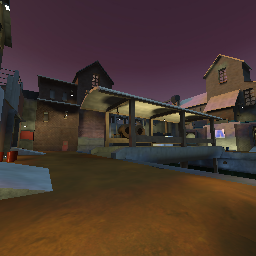</a>

            
<a href="maps-old/Industrial">Industrial</a>

        </td>
        <td>
            
<a href="maps-old/Isolation">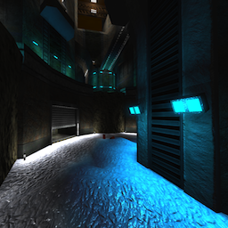</a>

            
<a href="maps-old/Isolation">Isolation</a>

        </td>
    </tr>
    <tr>
        <td>
            

            
<a href="maps-old/Lab">Lab</a>

        </td>
        <td>
            
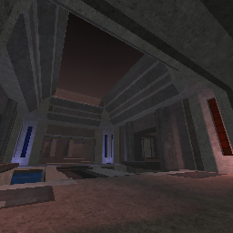

            
Tranquility

        </td>
    </tr>
</table>

### Removed in 1.3.0
[//]: # (HTML is easier to maintain as markdown when applying changes)
<table>
    <tr>
        <td>
            
<a href="maps-old/Alpha-Campaign">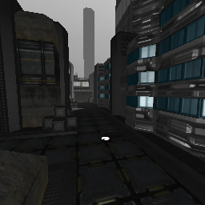</a>

            
<a href="maps-old/Alpha-Campaign">Alpha Campaign</a>

        </td>
    </tr>
</table>
