* TOC
{:toc}
## Official Maps

The maps below belong to the official Red Eclipse map rotation (`version_maplist` in `config/version.cfg`). Maps marked as work-in-progress (WIP) are included in the rotation under the `wip` filter while actively updated.

### Main & Team Maps
[//]: # (HTML is easier to maintain as markdown when applying changes)
<table>
    <tr>
        <td>
            
<a href="maps/Bloodlust">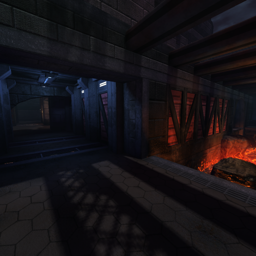</a>

            
<a href="maps/Bloodlust">Bloodlust</a>

        </td>
        <td>
            
<a href="maps/Conquest">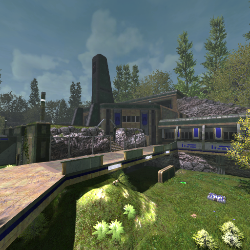</a>

            
<a href="maps/Conquest">Conquest</a>

        </td>
        <td>
            
<a href="maps/Dutility">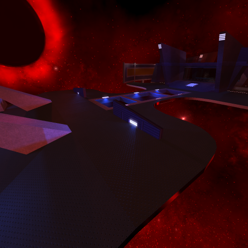</a>

            
<a href="maps/Dutility">Dutility</a>

        </td>
        <td>
            
<a href="maps/Echo">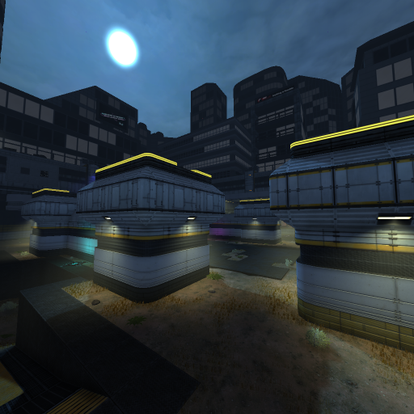</a>

            
<a href="maps/Echo">Echo</a>

        </td>
        <td>
            
<a href="maps/Edge">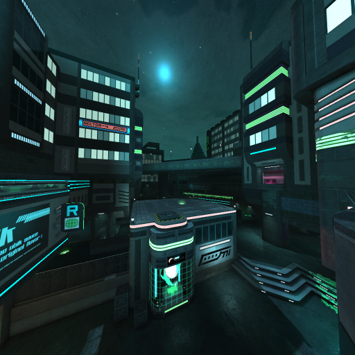</a>

            
<a href="maps/Edge">Edge</a>

        </td>
    </tr>
    <tr>
        <td>
            
<a href="maps/Cargo">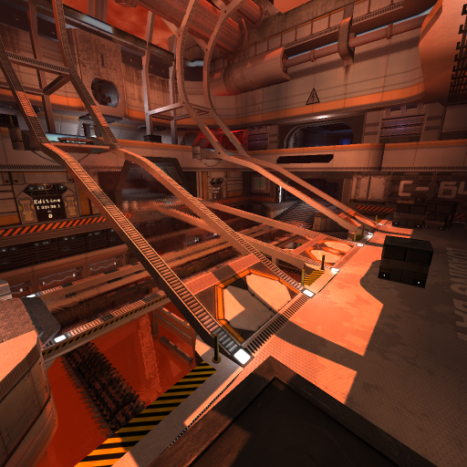</a>

            
<a href="maps/Cargo">Cargo 64</a>

        </td>
        <td>
            
<a href="maps/Fortitude">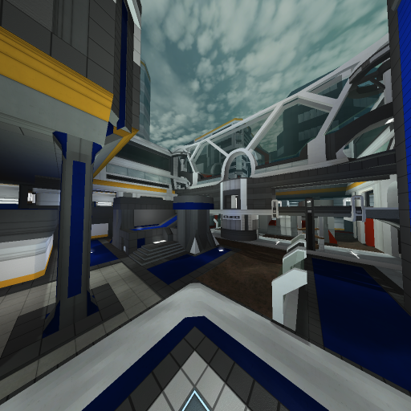</a>

            
<a href="maps/Fortitude">Fortitude</a>

        </td>
        <td>
            
<a href="maps/Institute">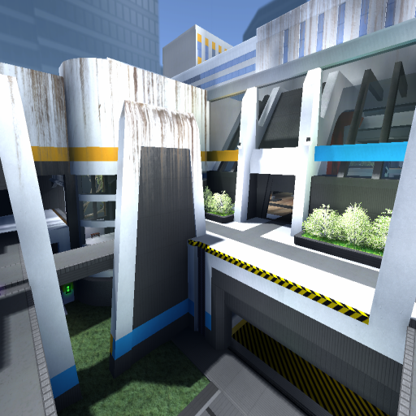</a>

            
<a href="maps/Institute">Institute</a>

        </td>
        <td>
            
<a href="maps/Octavus">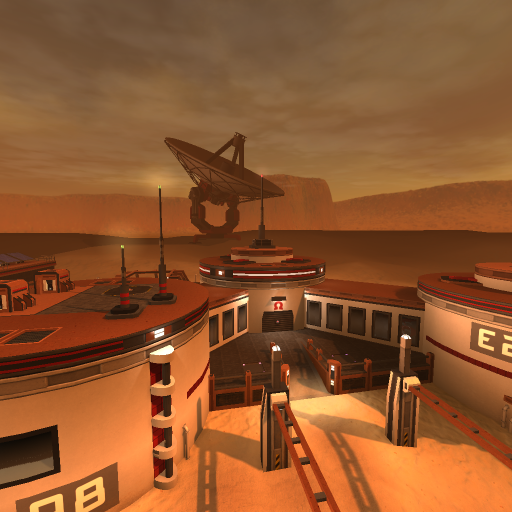</a>

            
<a href="maps/Octavus">To-Ru Octavus</a>

        </td>
        <td>
            
<a href="maps/Rift">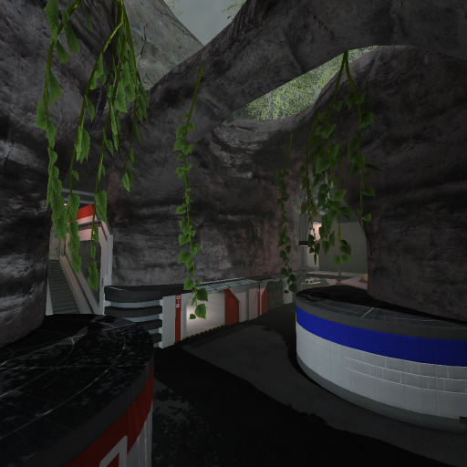</a>

            
<a href="maps/Rift">Rift</a>

        </td>
    </tr>
    <tr>
        <td>
            
<a href="maps/Trespass">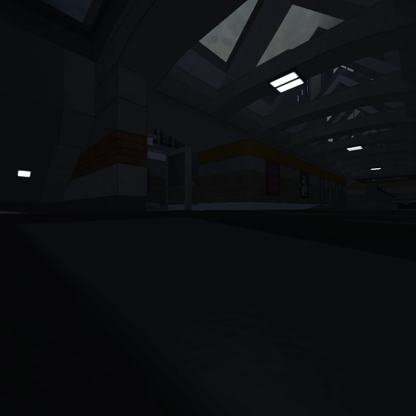</a>

            
<a href="maps/Trespass">Trespass</a>

        </td>
        <td>
            
<a href="maps/Ubik">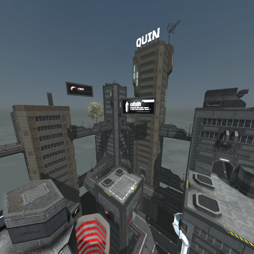</a>

            
<a href="maps/Ubik">Ubik</a>

        </td>
        <td>
            
<a href="maps/Venus">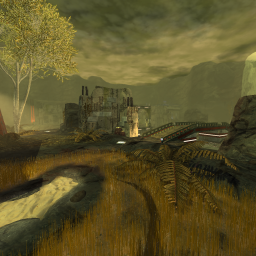</a>

            
<a href="maps/Venus">Venus</a>

        </td>
        <td>
            
<a href="maps/Wet">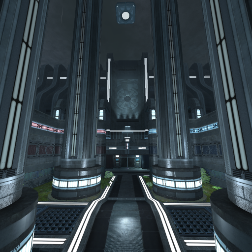</a>

            
<a href="maps/Wet">Wet</a>

        </td>
    </tr>
</table>

### Speedrun Maps
[//]: # (HTML is easier to maintain as markdown when applying changes)
<table>
    <tr>
        <td>
            

            
<a href="maps/Cyanide">Cyanide</a>

        </td>
        <td>
            
<a href="maps/Gauntlet">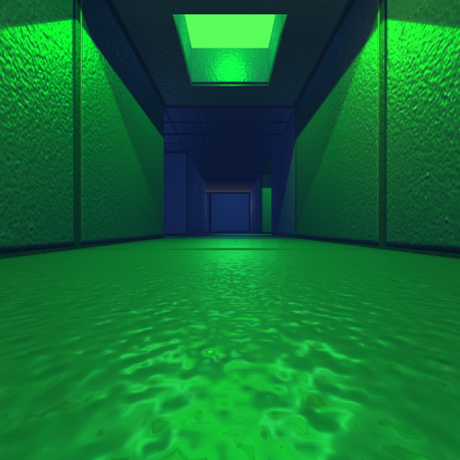</a>

            
<a href="maps/Gauntlet">The Gauntlet of death</a>

        </td>
        <td>
            
<a href="maps/Neodrive">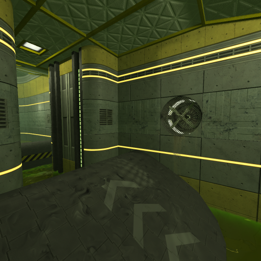</a>

            
<a href="maps/Neodrive">Neodrive</a>

        </td>
    </tr>
</table>

### Work-in-Progress (WIP) Maps
[//]: # (HTML is easier to maintain as markdown when applying changes)
<table>
    <tr>
        <td>
            
<a href="maps/Affluence">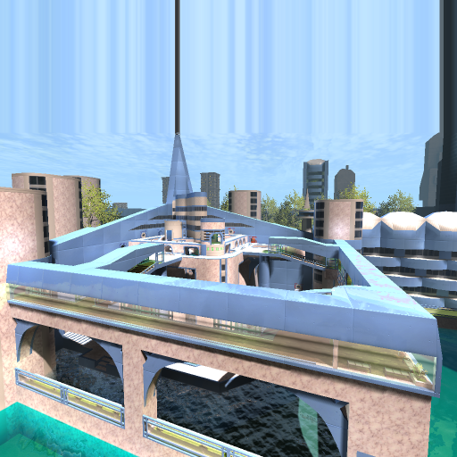</a>

            
<a href="maps/Affluence">Affluence</a>

        </td>
        <td>
            
<a href="maps/Atop">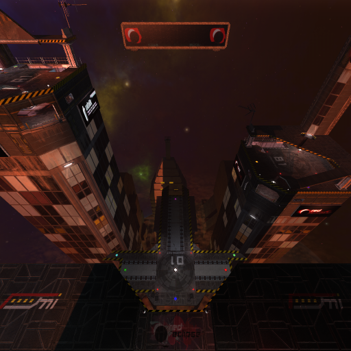</a>

            
<a href="maps/Atop">Atop</a>

        </td>
        <td>
            
<a href="maps/Castle">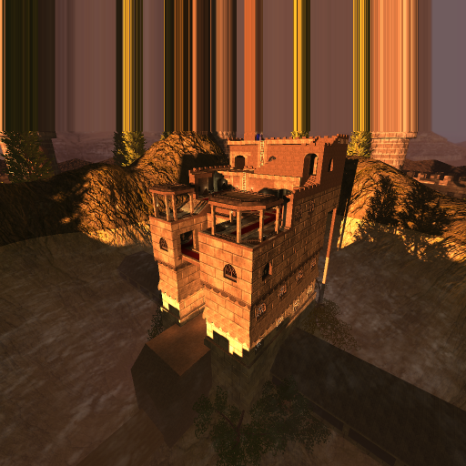</a>

            
<a href="maps/Castle">Castle</a>

        </td>
        <td>
            
<a href="maps/Center">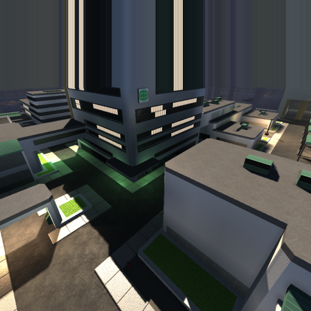</a>

            
<a href="maps/Center">Center</a>

        </td>
        <td>
            
<a href="maps/Deadcomplex">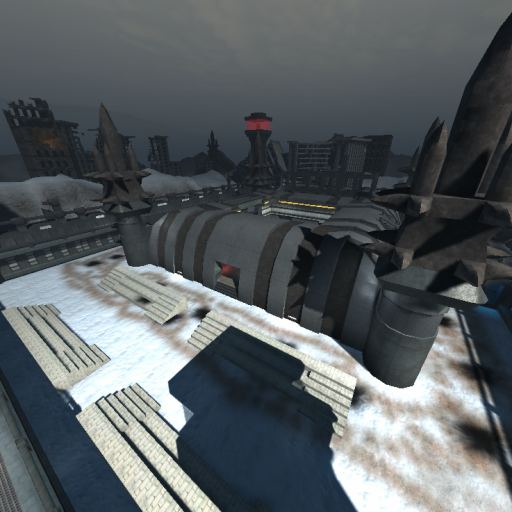</a>

            
<a href="maps/Deadcomplex">Dead Complex</a>

        </td>
    </tr>
    <tr>
        <td>
            
<a href="maps/Deathtrap">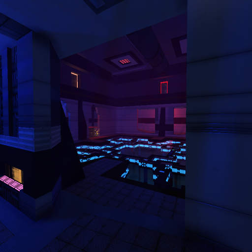</a>

            
<a href="maps/Deathtrap">Death Trap</a>

        </td>
        <td>
            
<a href="maps/Deli">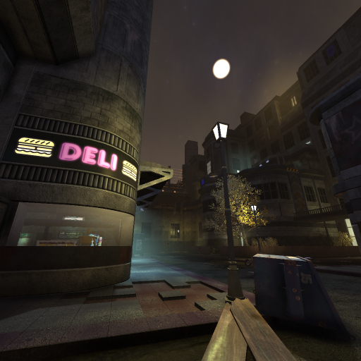</a>

            
<a href="maps/Deli">Delicatessen</a>

        </td>
        <td>
            
<a href="maps/Depot">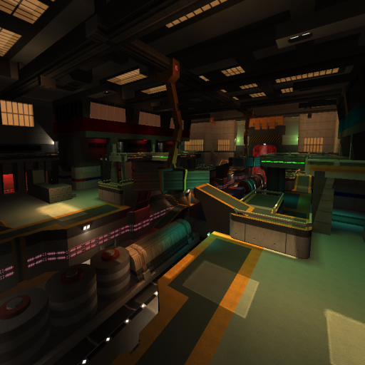</a>

            
<a href="maps/Depot">Depot</a>

        </td>
        <td>
            
<a href="maps/Fatal-Error">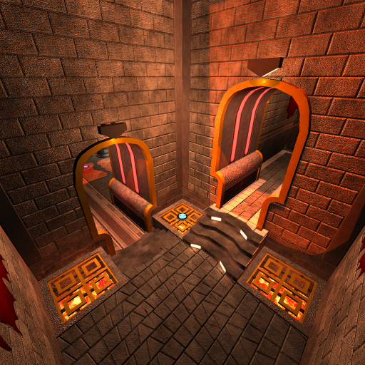</a>

            
<a href="maps/Fatal-Error">Fatal Error</a>

        </td>
        <td>
            
<a href="maps/Retrowave">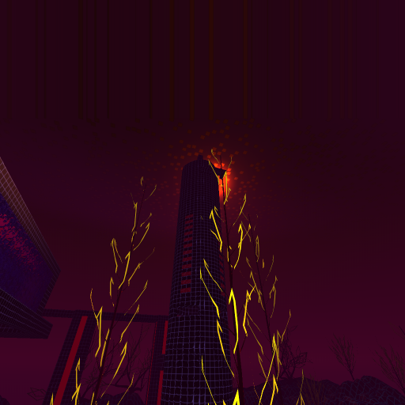</a>

            
<a href="maps/Retrowave">The Virtual Land</a>

        </td>
    </tr>
    <tr>
        <td>
            
<a href="maps/Rooftop">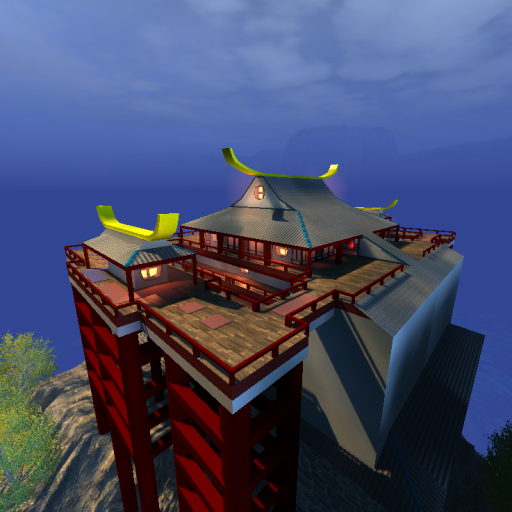</a>

            
<a href="maps/Rooftop">Unknown Rooftop</a>

        </td>
        <td>
            
<a href="maps/Space">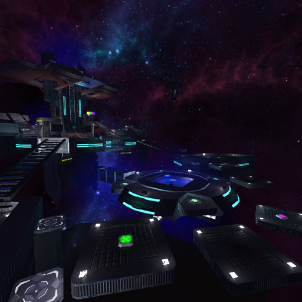</a>

            
<a href="maps/Space">Space Techno</a>

        </td>
        <td>
            
<a href="maps/Station">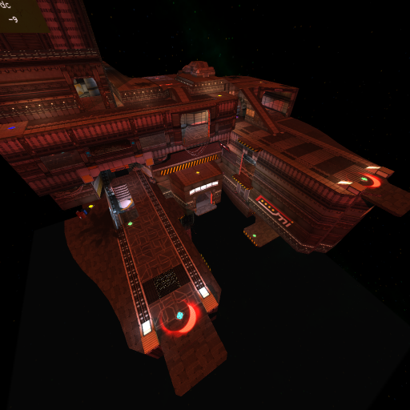</a>

            
<a href="maps/Station">Eclipse Station</a>

        </td>
        <td>
            
<a href="maps/Tomb">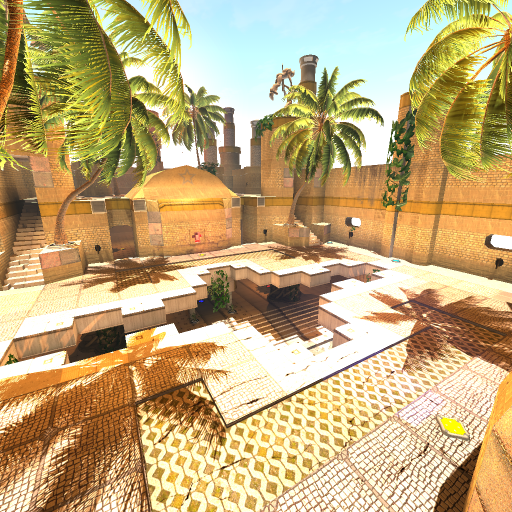</a>

            
<a href="maps/Tomb">Tomb</a>

        </td>
    </tr>
</table>
