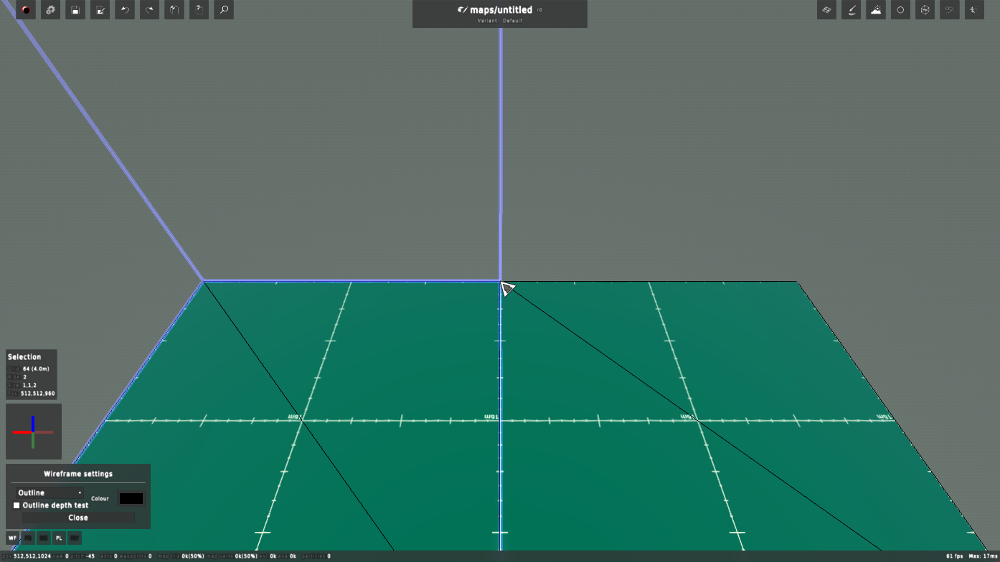
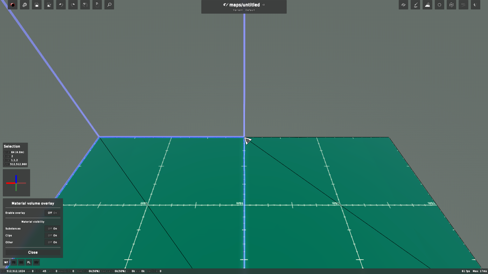
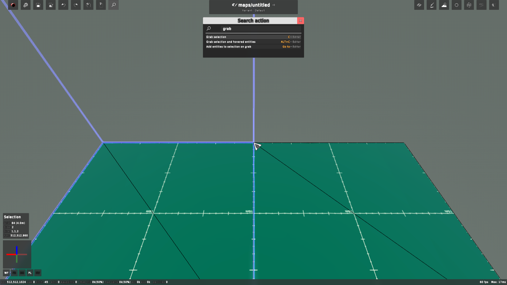
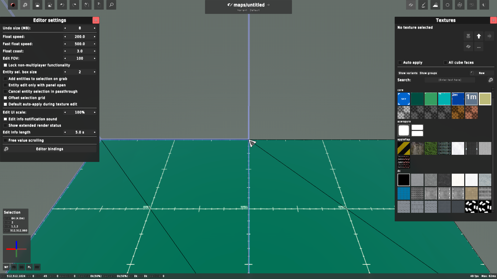
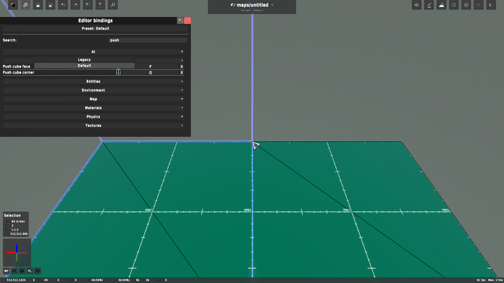

* TOC
{:toc}
The map editor's screen: the toolbar, the selection box and view toggles, action search, Tool panels, editor settings and key bindings. Press `F2` to enter or leave edit mode.

Keys here are the default bind preset's. Where the legacy preset differs, it is noted as "legacy"; see [Bind presets](#bind-presets).

## Cursor mode and keyboard

Edit mode starts in cursor mode: the mouse moves a cursor for the toolbar and Tool panels, and edits go where it points.

- `Tab`: switch between cursor mode and mouse look, where the mouse turns the view and edits go to the centre of the screen.
- Right click in cursor mode: a short click opens the context menu of what is under the cursor; holding it looks around. A mouse icon next to the cursor shows when there is a context menu.
- Up, Down, Left, Right and `Return`: move through and pick items in the Tool panel whose title bar is highlighted. With no such Tool panel, `Return` opens chat.
- `Esc`: back out of a Tool panel's keyboard navigation, else cancel the selection. The main menu is on the toolbar.
- `Shift` + wheel over a value: step the value. With **Free value scrolling** on (see [Editor settings](#editor-settings)), the wheel alone steps it.
- Right click on a value: **Copy value**, **Paste value** and **Reset value**.

## Toolbar

Hover a button for its name, what it does and its key. A button lights up while its Tool panel is open.

Left side:

- **Main menu**: open the main menu.
- **Editor settings**: open the [Editor settings](#editor-settings) Tool panel.
- **Save**: save the map, `Ctrl+S` (legacy `F8`).
- **Save as**: save the map under a new name, `Ctrl+Shift+S` (legacy `Shift+F8`).
- **Undo**: `Ctrl+Z` (legacy `Z`).
- **Redo**: `Ctrl+Shift+Z` (legacy `O`).
- **Copy**: copy the selection, `Ctrl+C` (legacy `C`).
- **Paste**: paste, `Ctrl+V` (legacy `V`).
- **Search action**: open [action search](#action-search), `F3`.

Centre, the map button: the map's name, its revision (`r` and a number, [`maprevision`](../variables/Editing#map-values), which goes up with each save) and the **Variant** being edited, Default or Alternate ([`forcemapvariant`](../variables/General#maps)). Click it to open the Map settings Tool panel (`Shift+F5`).

Right side, each opening its Tool panel:

- **Textures**: `F4` (legacy `F1`).
- **Blendmap paint**: painting with blend brushes; see [Blendmap](Blendmap).
- **Environment**: `F5`.
- **Entities**: `F6`.
- **Material volumes**: `F7`.
- **AI**: waypoints, `Shift+F6`; see [Waypoints](Waypoints). Not available online.
- **Map physics**: `Shift+F7`.

## View toggles

The five buttons under the selection box switch view modes; each is lit while its mode is on.

- **WF**: click for the Wireframe settings popup. `F9` cycles the mode without it.
  - Mode: **None**, **Wireframe** (draw geometry as edges, [`wireframe`](../variables/Editing#edit-view)) or **Outline** (draw the edges over the textures, [`outline`](../variables/Editing#edit-view)).
  - **Outline depth test**: outline only the surfaces in view ([`dtoutline`](../variables/Editing#edit-view)).
  - **Colour**: the outline's colour ([`outlinecolour`](../variables/Editing#edit-view)).
- **FB**: fullbright, every surface lit evenly ([`fullbright`](../variables/Editing#edit-view)), `B`.
- **BG**: blank geometry, textures drawn plain white ([`blankgeom`](../variables/Editing#edit-view)).
- **PL**: show physics layers ([`showphyslayers`](../variables/Editing#materials)), `Ctrl+P`.
- **MV**: click for the Material volume overlay popup. `Ctrl+M` (legacy `M`) turns the overlay on and off without it.
  - **Enable overlay**: show material volumes ([`showmat`](../variables/Editing#materials)).
  - **Substances**, **Clips**, **Other**: which kinds of material the overlay shows.

## Selection and status

- **Selection** box, bottom left: the grid size (`G` + wheel, with its size in metres), the selected **Side**, the selection's **Size** in grid cubes and its **Pos**ition. When the selection holds materials they are listed; hover one and click **X** to remove it.
- Under it, the axis view: the X (red), Y (green) and Z (blue) axes as the camera sees them.
- Next to the cursor: while pushing cubes or faces, the count of cubes changed.
- Info bar, bottom right: what an action just did, such as "Undo map edit". How long it stays and whether it chimes are in [Editor settings](#editor-settings).
- Status bar, along the bottom: camera position, yaw and pitch; entity count (selected in brackets) and waypoint count; map triangles and vertices; particles; frame rate and the slowest frame. **Show extended render status** adds renderer counts.

## Action search

`F3` opens **Search action** in the centre. Every editor action has a name, and many Tool panel settings are listed too.

- Type part of a name and the results show as you type. Up to 20 results are shown.
- An action result shows its key in orange and its category: AI, Editor, Entities, Environment, Map, Materials, Physics or Textures. A wheel icon and a `+` mean hold the key and turn the mouse wheel.
- A **Go to** result opens the Tool panel holding that setting and flashes it.
- `Return` leaves the text field, then Up and Down pick a result, `Return` runs it and `Esc` closes the search. Clicking a result runs it too.

## Tool panels

Each editor window is a Tool panel, opened on the left, in the centre or on the right of the screen, so up to three are open at once beside the map.

- Left: Editor settings and Editor bindings.
- Centre: action search, Map settings and the Image editor.
- Right: Textures, Blendmap paint, Environment, Entities, Material volumes, AI and Map physics. Opening one of these replaces the one open on the right.
- A Tool panel opened from inside another, such as Editor bindings from Editor settings, stacks on top of it. The arrow button on its title bar goes back to the one under it; the X closes it.
- Loading a map closes every Tool panel.

Keys that open Tool panels:

- `F4`: Textures (legacy `F1`).
- `F5`: Environment. `Shift+F5`: Map settings.
- `F6`: Entities. `Shift+F6`: AI. `Ctrl+E`: Entities in templates mode.
- `F7`: Material volumes. `Shift+F7`: Map physics.

The Image editor opens from an image field's right click menu (**Edit image**).

## Editor settings

Open it with the toolbar's Editor settings button.

- **Undo size (MB)**: memory kept for undo ([`undomegs`](../variables/Editing)).
- **Float speed**, **Fast float speed**: flying speed in edit mode, normally and with `Shift` held.
- **Float coast**: how gradually flying speeds up and slows down; higher drifts longer.
- **Edit FOV**: field of view in edit mode ([`editfov`](../variables/Interface#field-of-view)).
- **Lock non-multiplayer functionality**: when editing online, turn off the edits other players can't receive.
- **Entity sel. box size**: the size of the box you click to select an entity ([`entselradius`](../variables/Editing)).
- **Add entities to selection on grab**: when entities are already selected, grabbing adds the one under the cursor to them.
- **Entity edit only with panel open**: entities can be edited only while the Entities Tool panel is open.
- **Cancel entity selection in passthrough**: holding `Ctrl` (select through cubes) deselects entities.
- **Offset selection grid**: draw the selection grid slightly off the surfaces.
- **Default auto-apply during texture edit**: turn on auto-apply while editing a texture variant.
- **Edit UI scale**: the size of the toolbar and Tool panels, 100% to 150%.
- **Edit info notification sound**: chime when the info bar shows.
- **Show extended render status**: more renderer counts in the status bar.
- **Edit info length**: how long the info bar stays.
- **Free value scrolling**: the wheel steps values without `Shift`. It can get in the way of scrolling a Tool panel.
- **Editor bindings**: open the [Editor bindings](#editor-bindings) Tool panel.

## Editor bindings

Every editor action, grouped by category, with its key. Open it from the bottom of Editor settings, or search for "Editor bindings".

- **Preset**: shows the bind preset last applied; click to choose another.
- **Search**: show only the actions whose names contain the text, as you type.
- Each action's key field: click it and press a key, with `Ctrl`, `Alt` or `Shift` if you like, to bind it. An action has one key, and taking a key from another action leaves that action unbound.
- **X**: clear the action's key.
- A wheel icon marks an action you hold while turning the mouse wheel.

The mouse buttons, the wheel, the arrow keys, `Return` and the digits can't be bound here.

### Bind presets

A preset is a set of editor keys. **Default** is what a new player gets; **Legacy** keeps the older keys. Applying a preset sets its own keys and leaves other actions' keys as they are, and it is remembered between games. When a game update changes the legacy preset, the game applies it again once at start, so legacy players get its new keys, and says so in the console.

Legacy differs in these keys:

- Undo `Z`, redo `O`, copy `C`, paste `V`, flip `X`.
- Grab `Shift+C`, snap mode `Ctrl+Shift+C`; focus axis `Shift+X`, `Shift+Y`, `Shift+Z`.
- Apply texture `Y`, get texture `J`, Textures `F1`, recalculate lighting `F4`.
- Save `F8`, save as `Shift+F8`.
- Material overlay `M`, set material `Ctrl+M`.
- The default keys for applying and getting textures, save, save as and redo (`T`, `Shift+T`, `Ctrl+S`, `Ctrl+Shift+S`, `Ctrl+Shift+Z`) still work under legacy.

## Console

The console (`` ` `` or `/`) runs any editor command or variable. Type a name and a box under the input line shows its type, range, current and default value, usage and description. Every variable is listed in [Variables](../variables/).
