* TOC
{:toc}

| Icon | Mode description |
|-|-|
|  | Capture the opponent's flag and bring it back to your base, whilst defending your own |

### Tips & strategy

-   Being close to your team's flag (at base or dropped) provides a powerful [buff](Status-Effects) that enhances attack, defense, health regeneration and max health.
-   This buff is also applied when carrying your own team's flag (and to teammates near you), though not when carrying the enemy flag.
-   When your own flag is at its base, you can pick it up to relocate or safeguard it by pressing **F** next to it (unless Quick or Defend is active).
-   Press **F** to throw away any flags in your possession, or to pass a flag to teammates.
-   You cannot capture the opposing team's flag unless your team's flag is at its base (or you carry both your own flag and the enemy flag back to base).

### Mode-specific mutators

| Icon | Mutator | Description |
|-|-|-|
|  | **Quick** | Dropped flags instantly return to base |
|  | **Defend** | Dropped flags must be defended until they reset |
|  | **Protect** | Protect the flag and hold the enemy flag to score |
