* TOC
{:toc}
Red Eclipse has a variety of different game modes to choose from, with mutators to further tweak the experience. This page gives an overview of all the available modes and mutators. For further information and game strategy, see [Mutator Tips](../Mutator-Tips) and the articles about each of the below game modes.

## Modes

|                         Icon                          | Name                                     | Description                                                                                                                                                                                                                                                                                                                   |
|:-----------------------------------------------------:|------------------------------------------|-------------------------------------------------------------------------------------------------------------------------------------------------------------------------------------------------------------------------------------------------------------------------------------------------------------------------------|
| | [Demo](Demo)| View recorded matches.|
| | [Editing](../editing/Basics)| Make your own custom maps. See [Mapping Tips](../editing/Basics).|
| | [Deathmatch](Deathmatch)| Kill other players to score points using the [scoring system](Scoring-System). The player or team with the most points at the end wins!|
|     | [Capture the Flag](Capture-the-Flag)| Steal the other team's flag and return it to your base, without letting them take yours, to score points. Players that defend or escort their flag benefit from a powerful [buff](Status-Effects), while carrying flags adds weight.|
| | [Defend and Control](Defend-Control)| Stand near control points to secure them. Each control point you hold brings in a steady stream of points. While defending a secured control point, players receive a powerful [buff](Status-Effects). Before enemy control points can be secured, they are overthrown to a neutral state.|
| | [Bomber Ball](Bomber-Ball)| Grab the ball and deliver it to the enemy base to score, but watch your bomb timer - it will explode if you hold on to it too long. Pass it to your teammates (with the F key) to keep it going. If the other team holds it, kill the carrier or intercept it midair. Players defending their base get [buffed](Status-Effects). |
| | [Speedrun](Speedrun)| Try to complete the obstacle course in the fastest time (or the most laps with *Lapped*), carefully managing your impulse and executing various [parkour moves](Parkour-Guide).|

## Mutators

|                        Icon                          | Name      | Description                                                                                                                                                                                                                                      |
|:----------------------------------------------------:|-----------|--------------------------------------------------------------------------------------------------------------------------------------------------------------------------------------------------------------------------------------------------|
|        | FFA       | There are no teams, just every player for themselves in a free-for-all showdown. (Not available in CTF, Defend, or Speedrun Gauntlet, and in Bomber Ball it requires the *Hold* mutator)                                                          |
|       | Coop      | All human players are forced onto the same team, battling against a team of bots ... and there are more of them than there are of you.                                                                                                           |
|   | Instagib  | Players spawn with 1 HP, so any hit is lethal. Unless the *Medieval* or *Kaboom* mutators are also selected, players only spawn with the rifle. All rifle spawns on the map become grenade spawns.                                               |
|   | Medieval  | Players only have swords for weapons. All sword spawns on the map become grenade spawns.                                                                                                                                                         |
|     | Kaboom    | Players only have grenades and mines for weapons. Grenades and mines reload in this mutator like a normal loadout weapon, though your carry capacity remains default.                                                                            |
|       | Duel      | Only two players spawn at a time. Other players spectate the two fighting and wait their turn in line before playing again. Winner respawns the next round, loser goes to the back of the line. Beat your opponents the most to win the match.   |
|   | Survivor  | All players spawn as normal, but there is no health regeneration. The last player or team standing wins the round. Players that die are placed in a queue to respawn in the next round.                                                          |
|    | Classic   | Instead of having a menu to select your weapons from, you spawn with only a pistol. The rest of the weapons can be found on the ground, scattered across the map.                                                                                |
| 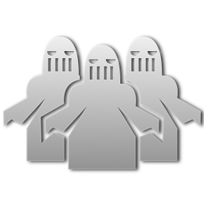 | Onslaught | Enemy drones and sentry turrets spawn in the maps while you fight against other players. If one of them kills you, you lose points!                                                                                                              |
|    | Vampire   | Dealing damage to opponents causes you to regain your own health. The default cap in this mutator is 200 health.                                                                                                                                 |
|     | Resize    | As your health decreases, you get smaller and start slowing down and the converse is true for gaining health. If combined with instagib, instead you get bigger every time you kill someone, until getting killed takes you back to normal size. |
|       | Hard      | No regeneration and radar.                                                                                                                                                                                                                       |
|      | Arena     | Players are able to carry all weapons at once.                                                                                                                                                                                                   |
|       | Dark      | Murder in the dark; reduces map lighting and gives players a flashlight.                                                                                                                                                                         |

## Mode-Exclusive Mutators
### Deathmatch

|                          Icon                        | Name       | Description                                                   |
|:----------------------------------------------------:|------------|---------------------------------------------------------------|
|  | Gladiator  | Fight in a confined area with increased pushback from damage. |
|  | Old School | Secure the most number of frags instead of points.            |

### Capture the Flag

|                            Icon                           | Name    | Description                                                                                                                                  |
|:---------------------------------------------------------:|---------|----------------------------------------------------------------------------------------------------------------------------------------------|
|    | Quick   | Touching your own team's loose flag will instantly teleport it back to your base, instead of having to escort it there on foot.              |
|   | Defend  | When your flag is taken, you cannot return it. You must protect it from where it's dropped until the timer resets.                           |
|  | Protect | You do not score for bringing a flag back to your base. Instead, simply pick up an opponent's flag and hold onto it for 15 seconds to score. |

### Defend and Control

|                          Icon                          | Name    | Description                                                                                                                                                             |
|:------------------------------------------------------:|---------|-------------------------------------------------------------------------------------------------------------------------------------------------------------------------|
|  | Quick | When capturing enemy points, they change directly to your color, instead of passing through a neutral "overthrown" state first. |
|   | King    | One base, gain points by holding the base. |

### Bomber Ball

|                           Icon                          | Name   | Description                                                                                                                                                                                                                                                                                        |
|:-------------------------------------------------------:|--------|----------------------------------------------------------------------------------------------------------------------------------------------------------------------------------------------------------------------------------------------------------------------------------------------------|
|  | Basket | The ball must be thrown into the goal to score, using the F key at a minimal distance.                                                                                                                                                                                                             |
|    | Hold   | There are no goals to drop the ball into. Instead, you get points for holding the ball as long as possible, but don't let the timer run out or you blow up and lose points! In this mode, the player holding the ball can kill opponents to reset the timer, allowing them to hold onto it longer. |
|  | Assault | The ball spawns at a teams base and they attack for half the round, then it swaps over.                                                                                                                                                                                                            |

### Speedrun

|                             Icon                                | Name      | Description                                                                                                                                                                                    |
|:---------------------------------------------------------------:|-----------|------------------------------------------------------------------------------------------------------------------------------------------------------------------------------------------------|
|     | Lapped    | Try to complete the obstacle course the most number of times, carefully managing your impulse and executing various [parkour moves](Parkour-Guide).                                         |
|  | Endurance | Laps must be completed without dying at all; dying resets you back to the start.                                                                                                               |
|   | Gauntlet  | One team (blue/Alpha) races to reach the goal and score points, while the other team (red/Omega) tries to shoot them before they can get there. Teams switch sides halfway through the match. |

## Mutatormatrix

|                        |      FFA      | Coop |   Instagib    |   Medieval    |    Kaboom     |      Duel       |    Survivor     | Classic | Onslaught |    Vampire     |    Resize     |     Hard      |     Arena     |     Dark      |
| :--------------------: | :-----------: | :--: | :-----------: | :-----------: | :-----------: | :-------------: | :-------------: | :-----: | :-------: | :------------: | :-----------: | :-----------: | :-----------: | :-----------: |
|        **Demo**        |       ✖       |  ✖   |       ✖       |       ✖       |       ✖       |        ✖        |        ✖        |    ✖    |     ✖     |       ✖        |       ✖       |       ✖       |       ✖       |       ✖       |
|      **Editing**       |   ✔6 |  ✖ |       ✖       |       ✖       |       ✖       |        ✖        |        ✖        |    ✔    |     ✖     |       ✔        |       ✔       |       ✔       |   ✔6 |     ✖       |
|     **Deathmatch**     |       ✔       |  ✔   |       ✔       |       ✔       |       ✔       |        ✔        |        ✔        |    ✔    |     ✔     |       ✔        |       ✔       |       ✔       |       ✔       |       ✔       |
|  **Capture the Flag**  |       ✖       |  ✔   |       ✔       |       ✔       |       ✔       |        ✔        |        ✔        |    ✔    |     ✔     |       ✔        |       ✔       |       ✔       |       ✔       |       ✔       |
| **Defend and Control** |       ✖       |  ✔   |       ✔       |       ✔       |       ✔       |        ✖        |        ✖        |    ✔    |     ✔     |       ✔        |       ✔       |       ✔       |       ✔       |       ✔       |
|    **Bomber Ball**     | ✖1 |  ✔   |       ✔       |       ✔       |       ✔       | ✔2,3 | ✔2,3 |    ✔    |     ✔     |       ✔        |       ✔       |       ✔       |       ✔       |       ✔       |
|      **Speedrun**      | ✔4 |  ✖   | ✖5 | ✖5 | ✖5 |        ✖        |        ✖        |    ✖    |     ✔     | ✖5  | ✖5 | ✖5 | ✖5 |       ✔       |
                                                                     
1 : available with mutator *Hold*  
2 : not available with mutator *Hold*  
3 : not available with mutator *Assault*  
4 : not available with mutator *Gauntlet*  
5 : available with mutator *Gauntlet*  
6 : implied by default in *Editing*  
