* TOC
{:toc}

| Icon | Mode description |
|-|-|
| | Try to complete the obstacle course in the fastest time. The number of laps does not matter.

### Tips & strategy

-   Attempt to complete the course as quickly as possible, however don't rush and get killed by a trap as there is a respawn delay.
-   In non-Gauntlet Speedrun modes, you pass through other players without colliding; turning player opacity down in settings can also keep your view unobstructed.

### Mode-specific mutators

| Icon | Mutator | Description |
|-|-|-|
|      | **Lapped**    | Try to complete the obstacle course the most number of times, carefully managing your impulse and executing various [parkour moves](Parkour-Guide).                                     |
|  | **Endurance** | Laps must be completed without dying at all; dying resets you back to the start.                                                                                                           |
|   | **Gauntlet**  | One team (blue/Alpha) tries to reach the goal and score points, while the other team (red/Omega) tries to shoot them before they can get there. Teams switch sides halfway through the match. |
