* TOC
{:toc}
## Claw Attack

[Click here to return to the main page.](Weapons-Guide)

| Utility | Power | Difficulty |
|-------------|-------------|----------------|
| Utility (☆☆☆) | Medium (☆☆☆) | Medium (☆☆☆) |

### Description

The Claw Attack is a lightweight, unlimited-ammo melee weapon with zero weight or speed penalty. Outside of custom servers or Editing mode, it primarily serves as the fallback melee weapon in mutators that restrict standard weapons, such as [Instagib](Modes-and-Mutators) and [Kaboom](Modes-and-Mutators). Because it deals solid melee damage and adds wall- and player-grabbing movement on its secondary fire, it shines in fast parkour engagements.

### Primary

Primary fire performs a fast, full-auto horizontal claw slash (`500` ms attack delay, `40` base head damage) with moderate stun and knockback. It is best paired with parkour impulse kicks to close the distance or finish off weakened opponents.

### Secondary

Secondary fire performs a slower claw strike (`800` ms attack delay, `40` base head damage with higher torso and limb multipliers than primary) that can grab walls (`grab` flag) and pull you directly toward enemies on hit, turning the Claw into a gap-closing mobility tool.

### Tips

- Use secondary fire against walls or elevated edges to grab and redirect your momentum across gaps.
- In Kaboom and Instagib, use the Claw when close-quarters combat makes explosives dangerous or while reloading.
- Combine primary slashes with an impulse kick (`Q` or `Ctrl`) for burst melee damage.

### Counterplay

Keep distance with ranged weapons or explosives when fighting a Claw user. Predict when they will lunge with secondary fire and use an impulse dodge to break their approach.

### Strengths & Weaknesses

**Strong against:**  Slow-reloading or close-disadvantaged enemies in Instagib and Kaboom when fighting around tight corners.

**Weak against:**  Any sustained ranged weapon across open sightlines.
