* TOC
{:toc}
## Trident

[Click here to return to the main page.](Weapons-Guide)

| Utility | Power | Difficulty |
|-------------|-------------|----------------|
| Flexible (☆☆☆) | High (☆☆☆☆) | Hard (☆☆☆☆) |

### Description

The Trident is a zero-weight loadout melee-hybrid weapon (`modweight 0`, `modspeed 0`) that trades sustained gunplay for rapid close-range thrusts and a thrown ranged spear. Both fire modes apply the [Shock](Status-Effects) status effect, slowing opponents and delaying shield/health regeneration.

### Primary

Primary fire (`500` ms delay, full-auto, scalable charge up to `500` ms) delivers a quick forward-thrusting stab (`30` max head damage) that shocks and stuns targets without consuming ammo. Holding primary lets you scale the strike's power before releasing.

### Secondary

Secondary fire (`800` ms delay, `500` ms charge time) charges and throws the Trident as a fast projectile (`500` max speed) that impales and heavily shocks its target (`65` base head damage, stronger stun than primary). Throwing the Trident consumes its single charge and drops the Trident as a pickup where it lands, so you must retrieve it (or pick up another weapon/wait for ammo regeneration mutators) before using it again.

### Tips

- Use primary thrusts while parkouring with zero speed penalty, keeping your throw ready as a finisher against fleeing targets.
- Aim throws near walls or predictable lanes so you can easily pick the Trident back up afterward.
- The Shock residual slows down fast Sword or Pistol opponents, letting you control melee duels.

### Counterplay

Bait out the secondary throw at medium range; if the Trident user misses their throw, they temporarily lose the weapon until they retrieve it. Keep out of thrust range with Flame Thrower, Shotgun, or ranged weapons.

### Strengths & Weaknesses

**Strong against:**  Close-range duelists reliant on parkour speed (Shock slows movement and delays regeneration).

**Weak against:**  Mid-to-long range weapons when your throw is missing or unretrieved.
