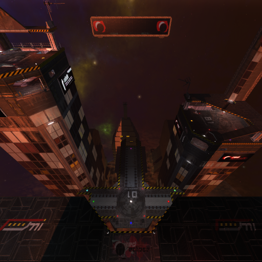

* TOC
{:toc}

## Information

| | |
|---|---|
| **Name** | Atop |
| **Author** | MirceaKitsune |
| **Filename** | `atop` |
| **Rotation** | WIP (Work in Progress) |
| **Size** | Large |
| **Lights** | 138 |
| **Entities** | 1006 |
| **Vslots** | 162 |
| **Recommended Modes** | Deathmatch, Capture the Flag, Defend and Control, King of the Hill, Bomber Ball, Hold |

## Overview

A central hub for space shipping, built on top of three skyscrapers reaching to the edge of the atmosphere. The air outside is as thin as the gravity.

## Spawn Register

| Weapon/Item | Count |
|---|:---:|
|  **Sword** | 1 |
|  **Shotgun** | 4 |
|  **SMG** | 4 |
|  **Flamer** | 2 |
|  **Plasma** | 3 |
|  **Zapper** | 3 |
|  **Rifle** | 4 |
|  **Corroder** | 2 |
|  **Grenade** | 6 |
|  **Mine** | 6 |
|  **Rocket** | 1 |
