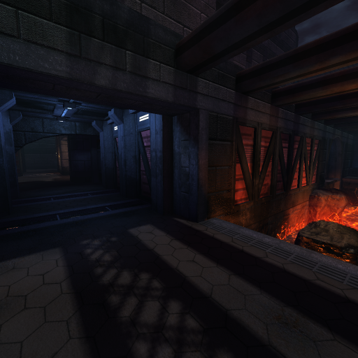

* TOC
{:toc}

## Information

| | |
|---|---|
| **Name** | Bloodlust |
| **Author** | ballist1c, Greaserpirate and Ricky Thomson |
| **Filename** | `bloodlust` |
| **Rotation** | Standard Rotation |
| **Size** | Small |
| **Lights** | 193 |
| **Entities** | 1079 |
| **Vslots** | 174 |
| **Recommended Modes** | Deathmatch, Duel |

## Overview

A repurposed mining facility used for the tournament.

## Spawn Register

| Weapon/Item | Count |
|---|:---:|
|  **Sword** | 2 |
|  **Shotgun** | 2 |
|  **SMG** | 2 |
|  **Flamer** | 2 |
|  **Plasma** | 2 |
|  **Zapper** | 2 |
|  **Rifle** | 2 |
|  **Grenade** | 5 |
|  **Mine** | 5 |
|  **Rocket** | 1 |
