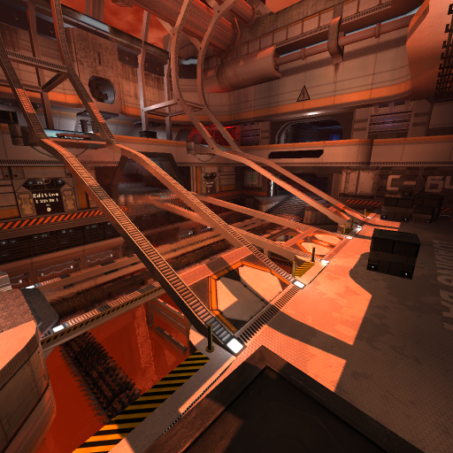

* TOC
{:toc}

## Information

| | |
|---|---|
| **Name** | Cargo 64 |
| **Author** | JoJo, W!CK3D, Dziq, dc and MirceaKitsune |
| **Filename** | `cargo` |
| **Rotation** | Standard Rotation |
| **Size** | Medium |
| **Lights** | 170 |
| **Entities** | 1932 |
| **Vslots** | 642 |
| **Recommended Modes** | Deathmatch, Defend and Control, King of the Hill, Hold |

## Overview

An old utilization facility for radiation materials. Abandoned long ago, now a place for holding smuggled cargo of all kinds.

## Spawn Register

| Weapon/Item | Count |
|---|:---:|
|  **Sword** | 3 |
|  **Shotgun** | 4 |
|  **SMG** | 4 |
|  **Flamer** | 3 |
|  **Plasma** | 2 |
|  **Zapper** | 2 |
|  **Rifle** | 3 |
|  **Corroder** | 2 |
|  **Grenade** | 13 |
|  **Mine** | 11 |
|  **Rocket** | 1 |
