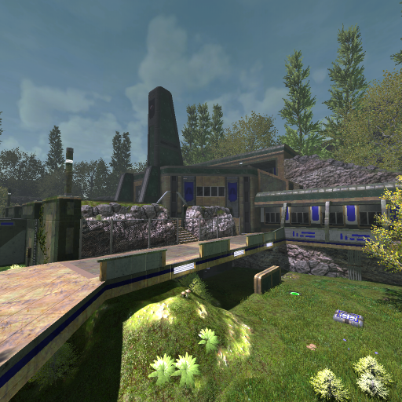

* TOC
{:toc}

## Information

| | |
|---|---|
| **Name** | Conquest |
| **Author** | Ricky Thomson |
| **Filename** | `conquest` |
| **Rotation** | Standard Rotation |
| **Size** | Large |
| **Lights** | 205 |
| **Entities** | 1986 |
| **Vslots** | 271 |
| **Recommended Modes** | Deathmatch, Capture the Flag, Defend and Control, King of the Hill, Bomber Ball, Hold |

## Overview

The war for Earth's natural resources ended long ago, but on this distant planet... The battle continues.

## Spawn Register

| Weapon/Item | Count |
|---|:---:|
|  **Sword** | 2 |
|  **Shotgun** | 3 |
|  **SMG** | 4 |
|  **Flamer** | 4 |
|  **Plasma** | 4 |
|  **Zapper** | 3 |
|  **Rifle** | 3 |
|  **Corroder** | 4 |
|  **Grenade** | 7 |
|  **Mine** | 5 |
|  **Rocket** | 1 |
