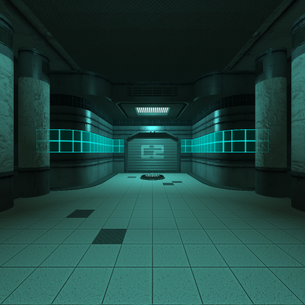

* TOC
{:toc}

## Information

| | |
|---|---|
| **Name** | Cyanide |
| **Author** | Ricky Thomson |
| **Filename** | `cyanide` |
| **Rotation** | Standard Rotation |
| **Size** | Standard |
| **Lights** | 93 |
| **Entities** | 856 |
| **Vslots** | 78 |
| **Recommended Modes** | Speedrun |

## Overview

A hazardous chemical facility used for testing endurance and agility.

## Spawn Register

No weapon pickups (players spawn ready for Speedrun).
