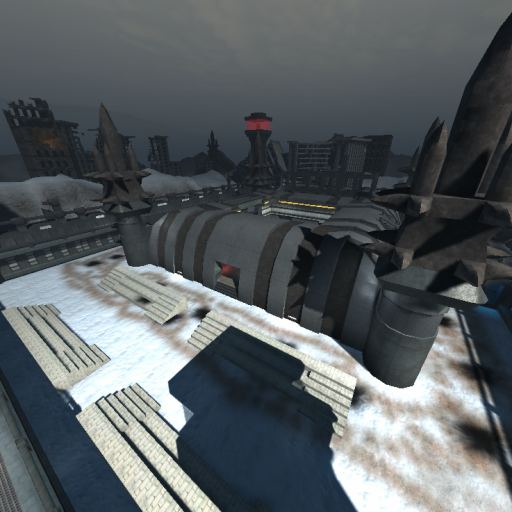

* TOC
{:toc}

## Information

| | |
|---|---|
| **Name** | Dead Complex |
| **Author** | Jonathan 'Wicked' Roels & Jonathan 'Ulukai' De Nil, remix by SniperGoth |
| **Filename** | `deadcomplex` |
| **Rotation** | WIP (Work in Progress) |
| **Size** | Small |
| **Lights** | 245 |
| **Entities** | 538 |
| **Vslots** | 868 |
| **Recommended Modes** | Deathmatch, Capture the Flag, Defend and Control, King of the Hill, Bomber Ball, Hold, Duel |

## Overview

Despite the city ruins, there was a complex still functioning. The shield is currently down, so it's better to investigate.

## Spawn Register

| Weapon/Item | Count |
|---|:---:|
|  **Sword** | 4 |
|  **Shotgun** | 4 |
|  **SMG** | 4 |
|  **Flamer** | 4 |
|  **Plasma** | 4 |
|  **Zapper** | 4 |
|  **Rifle** | 4 |
|  **Corroder** | 4 |
|  **Grenade** | 15 |
|  **Mine** | 13 |
|  **Rocket** | 3 |
|  **Eclipse** | 1 |
