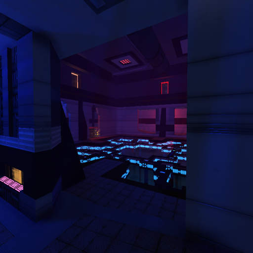

* TOC
{:toc}

## Information

| | |
|---|---|
| **Name** | Death Trap |
| **Author** | Derek Stegall, Architect, Favorito, and SniperGoth |
| **Filename** | `deathtrap` |
| **Rotation** | WIP (Work in Progress) |
| **Size** | Small |
| **Lights** | 104 |
| **Entities** | 627 |
| **Vslots** | 954 |
| **Recommended Modes** | Deathmatch, Capture the Flag, Defend and Control, King of the Hill, Bomber Ball, Hold |

## Overview

Death Trap is an official map in Red Eclipse (`deathtrap`).

## Spawn Register

| Weapon/Item | Count |
|---|:---:|
|  **Sword** | 4 |
|  **Shotgun** | 4 |
|  **SMG** | 4 |
|  **Flamer** | 3 |
|  **Plasma** | 3 |
|  **Zapper** | 4 |
|  **Rifle** | 4 |
|  **Grenade** | 12 |
|  **Mine** | 12 |
|  **Rocket** | 6 |
