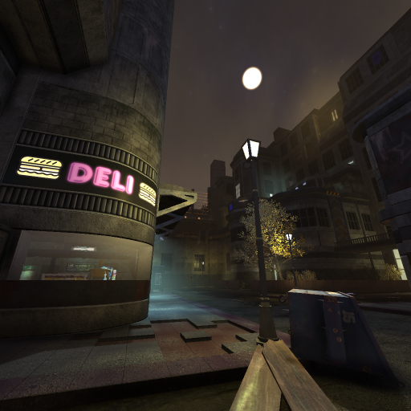

* TOC
{:toc}

## Information

| | |
|---|---|
| **Name** | Delicatessen |
| **Author** | LuckyStrike-Rx and Ricky Thomson |
| **Filename** | `deli` |
| **Rotation** | WIP (Work in Progress) |
| **Size** | Medium |
| **Lights** | 251 |
| **Entities** | 1783 |
| **Vslots** | 455 |
| **Recommended Modes** | Deathmatch, Capture the Flag, Defend and Control, Bomber Ball, Hold, Duel |

## Overview

Delicatessen is an official map in Red Eclipse (`deli`).

## Spawn Register

| Weapon/Item | Count |
|---|:---:|
|  **Sword** | 4 |
|  **Shotgun** | 4 |
|  **SMG** | 6 |
|  **Flamer** | 4 |
|  **Plasma** | 4 |
|  **Zapper** | 4 |
|  **Rifle** | 4 |
|  **Corroder** | 2 |
|  **Grenade** | 23 |
|  **Mine** | 5 |
|  **Rocket** | 4 |
