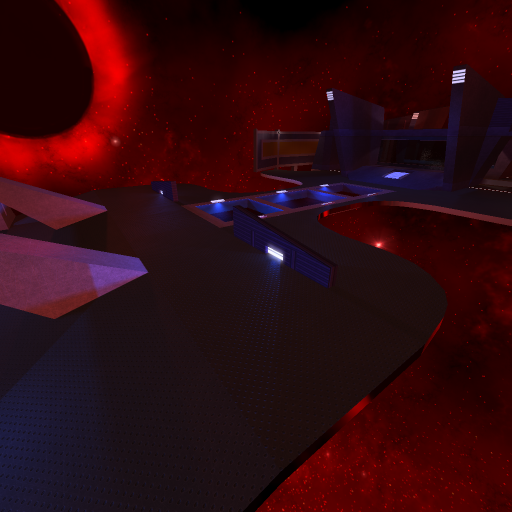

* TOC
{:toc}

## Information

| | |
|---|---|
| **Name** | Dutility |
| **Author** | Quinton Reeves and Derek 'JoJo' Stegall |
| **Filename** | `dutility` |
| **Rotation** | Standard Rotation |
| **Size** | Small |
| **Lights** | 48 |
| **Entities** | 251 |
| **Vslots** | 39 |
| **Recommended Modes** | Deathmatch, Capture the Flag, Defend and Control, King of the Hill, Bomber Ball, Hold, Duel, Gladiator |

## Overview

A death-defying platform in the middle of space, where no-one can hear you scream.

## Spawn Register

| Weapon/Item | Count |
|---|:---:|
|  **Sword** | 3 |
|  **Shotgun** | 2 |
|  **SMG** | 2 |
|  **Flamer** | 2 |
|  **Plasma** | 2 |
|  **Zapper** | 2 |
|  **Rifle** | 2 |
|  **Grenade** | 8 |
|  **Mine** | 4 |
|  **Rocket** | 1 |
