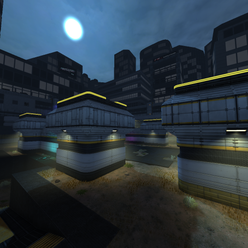

* TOC
{:toc}

## Information

| | |
|---|---|
| **Name** | Echo |
| **Author** | JoJo, W!CK3D, Ulukai and dc |
| **Filename** | `echo` |
| **Rotation** | Standard Rotation |
| **Size** | Small |
| **Lights** | 76 |
| **Entities** | 614 |
| **Vslots** | 500 |
| **Recommended Modes** | Deathmatch, Capture the Flag, Defend and Control, King of the Hill, Bomber Ball, Hold, Duel, Gladiator |

## Overview

The courtyard of a research laboratory needs to be protected. The development of a new secret laser weapon must go on!

## Spawn Register

| Weapon/Item | Count |
|---|:---:|
|  **Sword** | 2 |
|  **Shotgun** | 2 |
|  **SMG** | 2 |
|  **Flamer** | 2 |
|  **Plasma** | 2 |
|  **Zapper** | 2 |
|  **Rifle** | 2 |
|  **Corroder** | 2 |
|  **Grenade** | 4 |
|  **Mine** | 2 |
|  **Rocket** | 2 |
