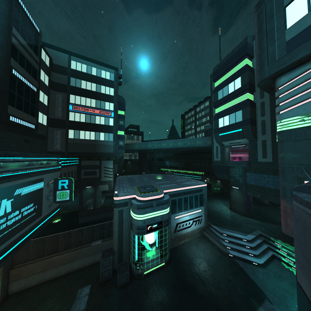

* TOC
{:toc}

## Information

| | |
|---|---|
| **Name** | Edge |
| **Author** | Ricky Thomson |
| **Filename** | `edge` |
| **Rotation** | Standard Rotation |
| **Size** | Medium |
| **Lights** | 164 |
| **Entities** | 886 |
| **Vslots** | 312 |
| **Recommended Modes** | Deathmatch, Defend and Control, King of the Hill, Hold |

## Overview

The shady backstreets at the edge of the city, where crime and corporate interests tangle together.

## Spawn Register

| Weapon/Item | Count |
|---|:---:|
|  **Sword** | 2 |
|  **Shotgun** | 2 |
|  **SMG** | 2 |
|  **Flamer** | 2 |
|  **Plasma** | 2 |
|  **Zapper** | 2 |
|  **Rifle** | 2 |
|  **Corroder** | 2 |
|  **Grenade** | 2 |
|  **Mine** | 2 |
|  **Rocket** | 1 |
