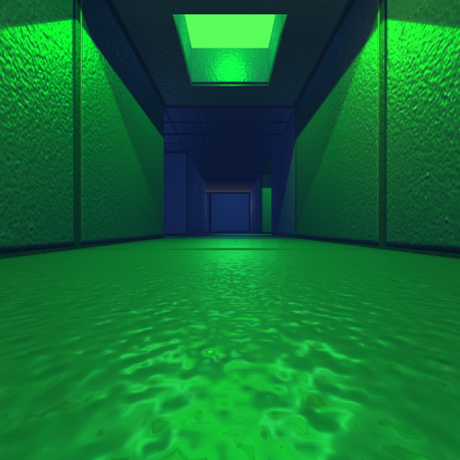

* TOC
{:toc}

## Information

| | |
|---|---|
| **Name** | The Gauntlet of death |
| **Author** | SniperGoth |
| **Filename** | `gauntlet` |
| **Rotation** | Standard Rotation |
| **Size** | Standard |
| **Lights** | 41 |
| **Entities** | 171 |
| **Vslots** | 725 |
| **Recommended Modes** | Speedrun |

## Overview

The Gauntlet of death is an official map in Red Eclipse (`gauntlet`).

## Spawn Register

No weapon pickups (players spawn ready for Speedrun).
