* TOC
{:toc}
## Official Maps

The maps below belong to the official Red Eclipse map rotation (`version_maplist` in `config/version.cfg`). Maps marked as work-in-progress (WIP) are included in the rotation under the `wip` filter while actively updated.

### Main & Team Maps
[//]: # (HTML is easier to maintain as markdown when applying changes)
<table>
    <tr>
        <td>
            
<a href="Bloodlust">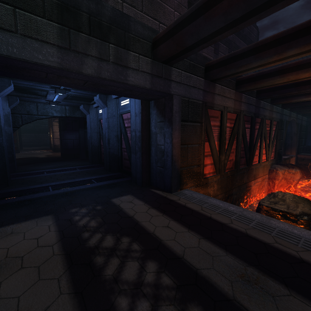</a>

            
<a href="Bloodlust">Bloodlust</a>

        </td>
        <td>
            
<a href="Conquest">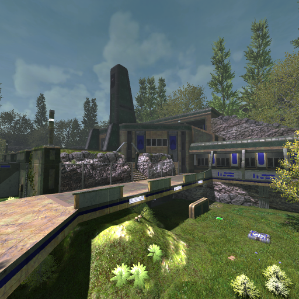</a>

            
<a href="Conquest">Conquest</a>

        </td>
        <td>
            
<a href="Dutility">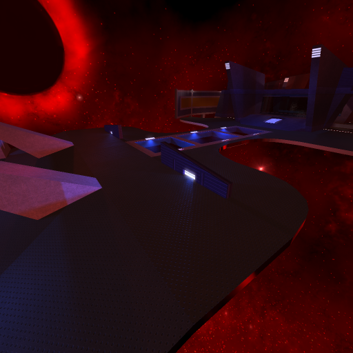</a>

            
<a href="Dutility">Dutility</a>

        </td>
        <td>
            
<a href="Echo">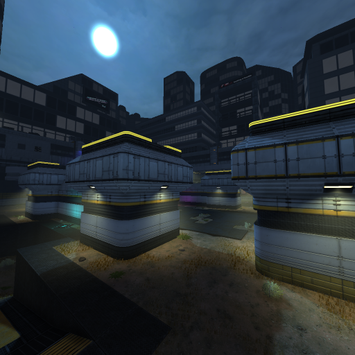</a>

            
<a href="Echo">Echo</a>

        </td>
        <td>
            
<a href="Edge">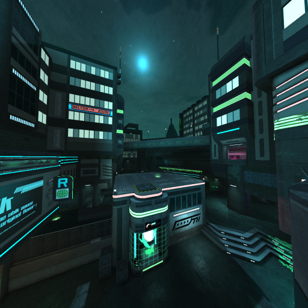</a>

            
<a href="Edge">Edge</a>

        </td>
    </tr>
    <tr>
        <td>
            
<a href="Cargo">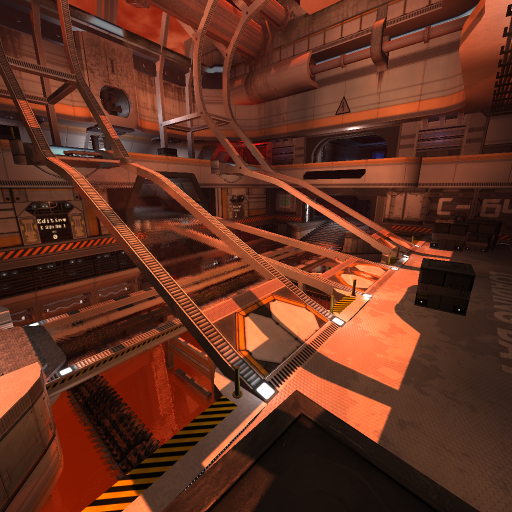</a>

            
<a href="Cargo">Cargo 64</a>

        </td>
        <td>
            
<a href="Fortitude">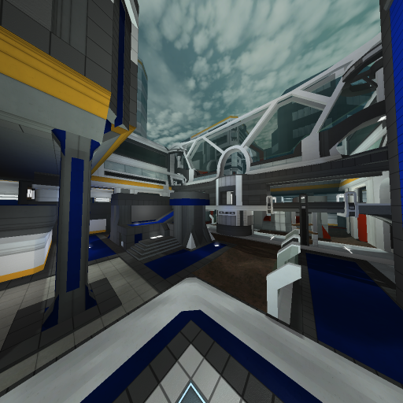</a>

            
<a href="Fortitude">Fortitude</a>

        </td>
        <td>
            
<a href="Institute">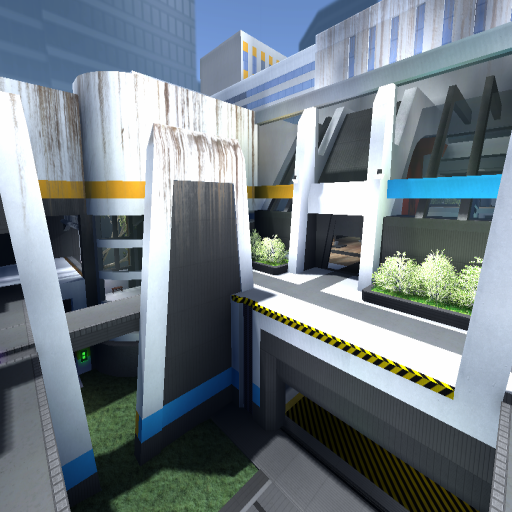</a>

            
<a href="Institute">Institute</a>

        </td>
        <td>
            
<a href="Octavus">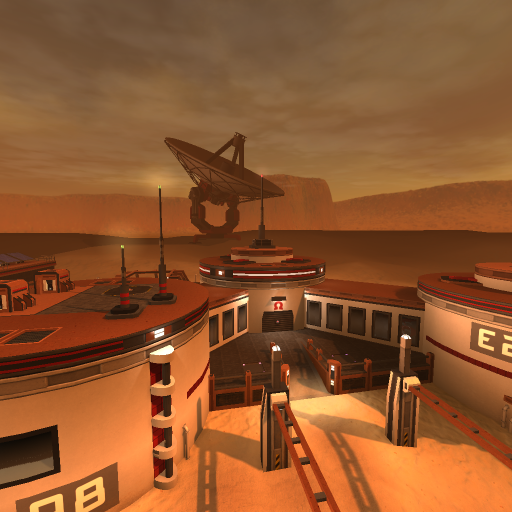</a>

            
<a href="Octavus">To-Ru Octavus</a>

        </td>
        <td>
            
<a href="Rift">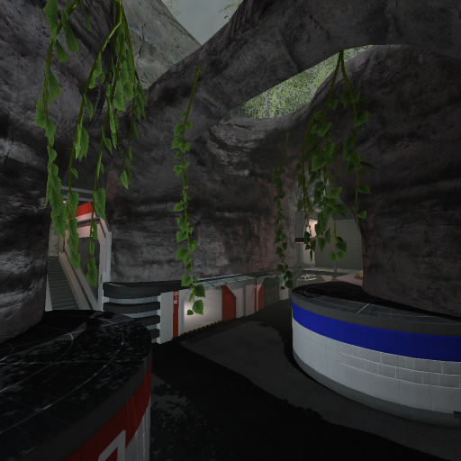</a>

            
<a href="Rift">Rift</a>

        </td>
    </tr>
    <tr>
        <td>
            
<a href="Trespass">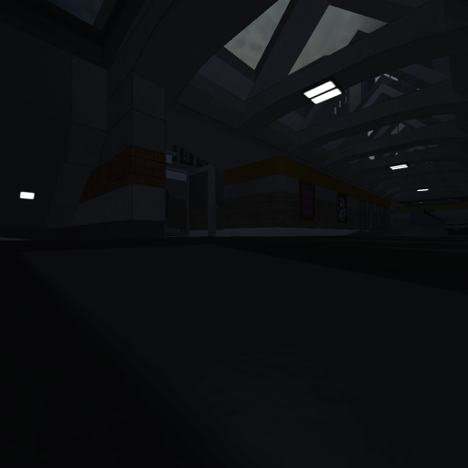</a>

            
<a href="Trespass">Trespass</a>

        </td>
        <td>
            
<a href="Ubik">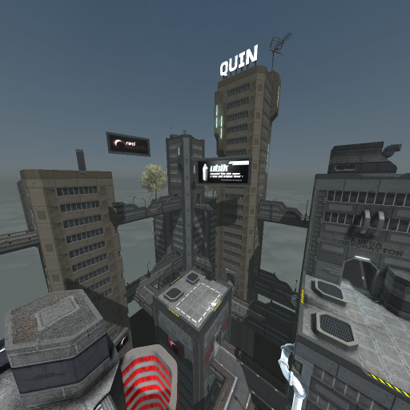</a>

            
<a href="Ubik">Ubik</a>

        </td>
        <td>
            
<a href="Venus">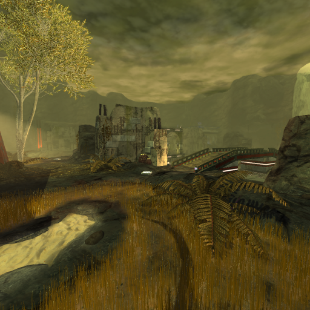</a>

            
<a href="Venus">Venus</a>

        </td>
        <td>
            
<a href="Wet">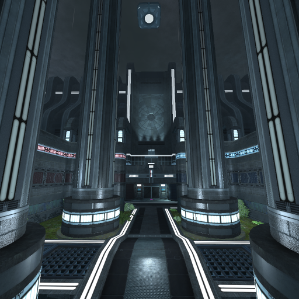</a>

            
<a href="Wet">Wet</a>

        </td>
    </tr>
</table>

### Speedrun Maps
[//]: # (HTML is easier to maintain as markdown when applying changes)
<table>
    <tr>
        <td>
            
<a href="Cyanide">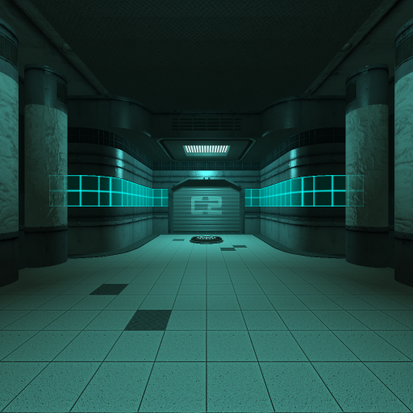</a>

            
<a href="Cyanide">Cyanide</a>

        </td>
        <td>
            
<a href="Gauntlet">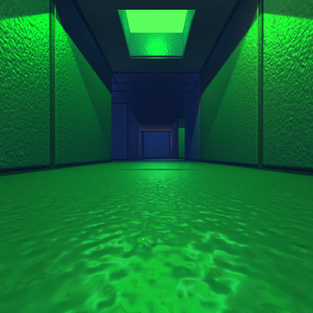</a>

            
<a href="Gauntlet">The Gauntlet of death</a>

        </td>
        <td>
            
<a href="Neodrive">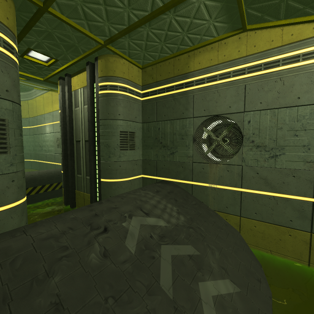</a>

            
<a href="Neodrive">Neodrive</a>

        </td>
    </tr>
</table>

### Work-in-Progress (WIP) Maps
[//]: # (HTML is easier to maintain as markdown when applying changes)
<table>
    <tr>
        <td>
            
<a href="Affluence">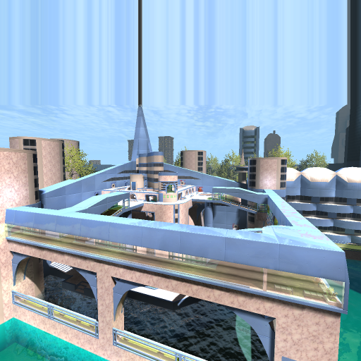</a>

            
<a href="Affluence">Affluence</a>

        </td>
        <td>
            
<a href="Atop">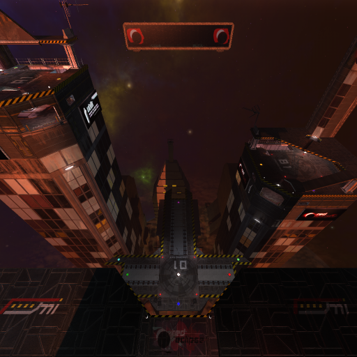</a>

            
<a href="Atop">Atop</a>

        </td>
        <td>
            
<a href="Castle">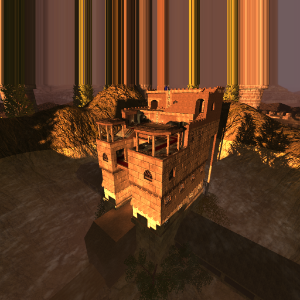</a>

            
<a href="Castle">Castle</a>

        </td>
        <td>
            
<a href="Center">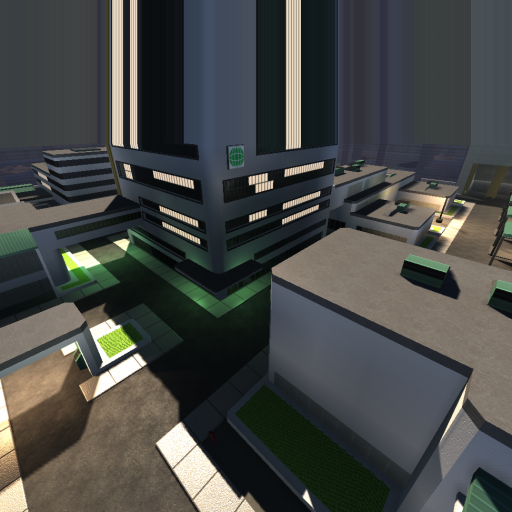</a>

            
<a href="Center">Center</a>

        </td>
        <td>
            
<a href="Deadcomplex">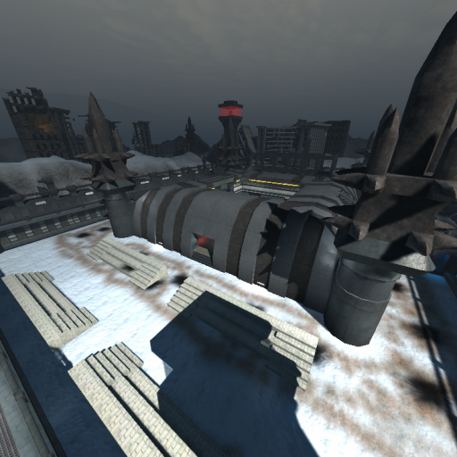</a>

            
<a href="Deadcomplex">Dead Complex</a>

        </td>
    </tr>
    <tr>
        <td>
            
<a href="Deathtrap">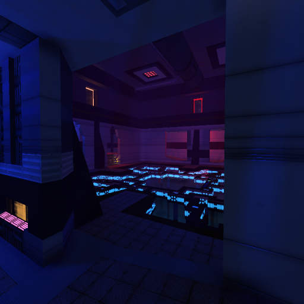</a>

            
<a href="Deathtrap">Death Trap</a>

        </td>
        <td>
            
<a href="Deli">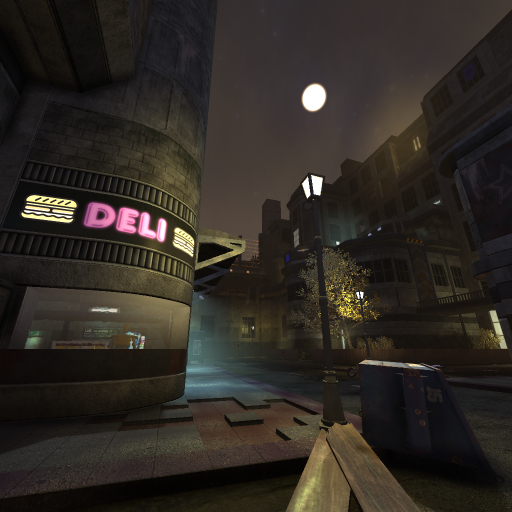</a>

            
<a href="Deli">Delicatessen</a>

        </td>
        <td>
            
<a href="Depot">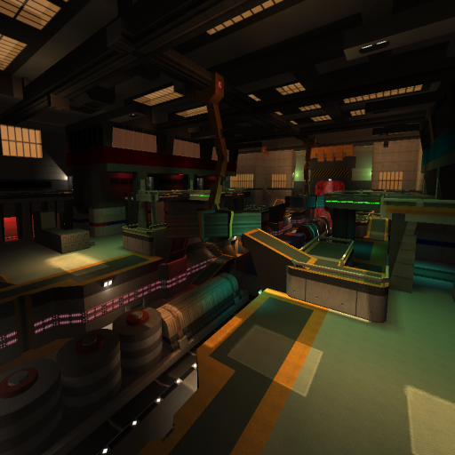</a>

            
<a href="Depot">Depot</a>

        </td>
        <td>
            
<a href="Fatal-Error">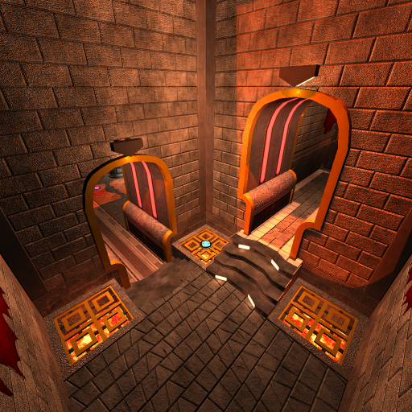</a>

            
<a href="Fatal-Error">Fatal Error</a>

        </td>
        <td>
            
<a href="Retrowave">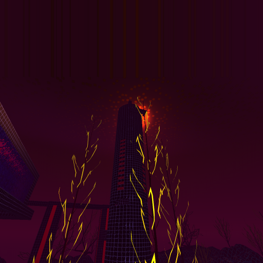</a>

            
<a href="Retrowave">The Virtual Land</a>

        </td>
    </tr>
    <tr>
        <td>
            
<a href="Rooftop">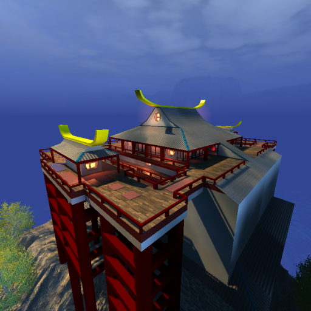</a>

            
<a href="Rooftop">Unknown Rooftop</a>

        </td>
        <td>
            
<a href="Space">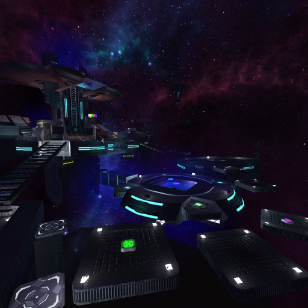</a>

            
<a href="Space">Space Techno</a>

        </td>
        <td>
            
<a href="Station">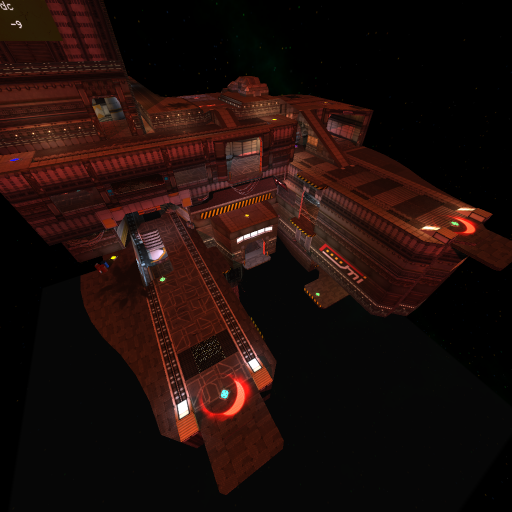</a>

            
<a href="Station">Eclipse Station</a>

        </td>
        <td>
            
<a href="Tomb">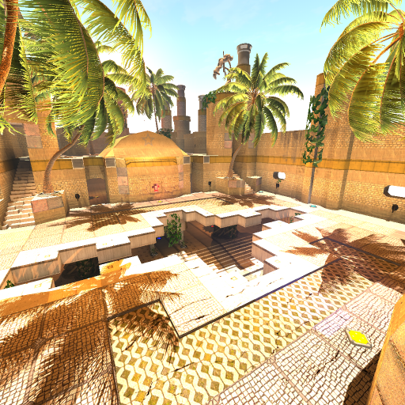</a>

            
<a href="Tomb">Tomb</a>

        </td>
    </tr>
</table>
