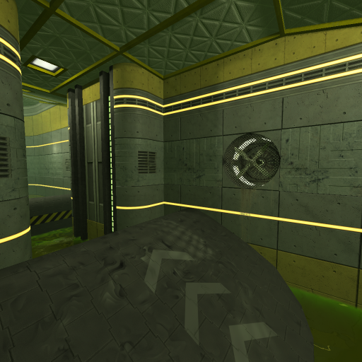

* TOC
{:toc}

## Information

| | |
|---|---|
| **Name** | Neodrive |
| **Author** | Kirill 'TristamK' Kolesnikov and Ricky Thomson |
| **Filename** | `neodrive` |
| **Rotation** | Standard Rotation |
| **Size** | Standard |
| **Lights** | 85 |
| **Entities** | 423 |
| **Vslots** | 75 |
| **Recommended Modes** | Speedrun |

## Overview

Neodrive is an official map in Red Eclipse (`neodrive`).

## Spawn Register

No weapon pickups (players spawn ready for Speedrun).
