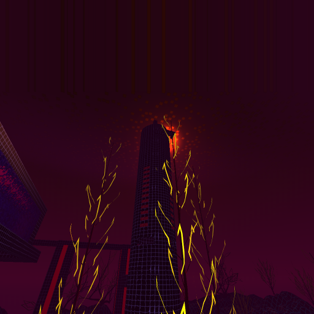

* TOC
{:toc}

## Information

| | |
|---|---|
| **Name** | The Virtual Land |
| **Author** | SniperGoth |
| **Filename** | `retrowave` |
| **Rotation** | WIP (Work in Progress) |
| **Size** | Standard |
| **Lights** | 18 |
| **Entities** | 275 |
| **Vslots** | 748 |
| **Recommended Modes** | Speedrun |

## Overview

Something isn't quite right around these lands...

## Spawn Register

No weapon pickups (players spawn ready for Speedrun).
