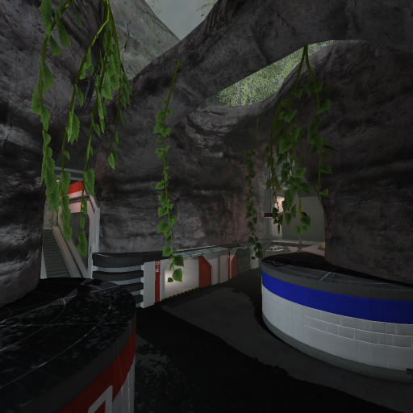

* TOC
{:toc}

## Information

|                            |                                      |
|----------------------------|--------------------------------------|
| **Name** | Rift |
| **Author** | Alex Foster and Quinton Reeves |
| **Filename**               | rift                                 |
| **Rotation** | Standard Rotation |
| **Release Date**           | 2019-11-02                           |
| **Introduced in**          | 2.0.0                                |
| **Size**                   | Medium (6-10)                        |
| **Complexity**             | Moderate                             |
| **Theme**                  | Forest                               |
| **Environmental Features** | N/A                                  |
| **Day/Night**              | ✔/✔                                  |
| **Lights** | 131 |
| **Entities** | 635 |
| **Vertices**               | 87k                                  |
| **Triangles**              | 120k                                 |
| **Vslots** | 274 |
| **Recommended Modes** | Deathmatch, Capture the Flag, Defend and Control, King of the Hill, Bomber Ball, Hold |

## Overview
This is the map formerly known by its assigned layout name, ctf13.

Tripartiate map with alpha and omega bases at the far corners. The long chasms leave players exposed to rifle fire, while the tight corridors are suitable for ambushes.

## Notes & Strategies

- The two mines are both local to the team bases. They may be useful corridor stuffers to cut off one mode of entry into the flag area.
- Stay low and cross the central area quickly to avoid rifle fire
- This is the most intensive map shipped with RE2 at maximum settings. Turn `mapeffects` down if performance suffers.

## Spawn Register

| Weapon/Item | Count |
|---|:---:|
|  **Sword** | 0 |
|  **Shotgun** | 2 |
|  **SMG** | 2 |
|  **Flamer** | 2 |
|  **Plasma** | 2 |
|  **Zapper** | 2 |
|  **Rifle** | 2 |
|  **Grenade** | 4 |
|  **Mine** | 2 |
|  **Rocket** | 1 |
