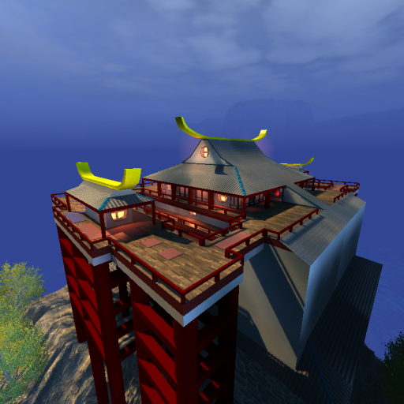

* TOC
{:toc}

## Information

|                            |                                           |
|----------------------------|-------------------------------------------|
| **Name** | Unknown Rooftop |
| **Author** | SniperGoth |
| **Filename**               | rooftop                                   |
| **Rotation** | WIP (Work in Progress) |
| **Release Date**           | 2014-10-30                                |
| **Size**                   | Large (6-10)                              |
| **Complexity**             | Medium                                    |
| **Theme**                  | Skyscraper                                |
| **Environmental Features** | Skyscraper                                |
| **Day/Night**              | ✔/✖                                       |
| **Lights** | 46 |
| **Entities** | 324 |
| **Vslots** | 730 |
| **Vertices**               | ~240 000                                  |
| **Triangles**              | ~212 000                                  |
| **Recommended Modes** | Deathmatch, Defend and Control, King of the Hill, Hold, Duel, Gladiator |

## Review

Twin towers of opposing colors stand poised for conflict at the top. Watch out for people in the corridors underneath the Omega base and above the Alpha base.

## Notes & Strategies

- In CTF, be prepared to defend the corridors above the Alpha base and below the Omega base.
- The rocket is beneath the center bridge.

## Spawn Register

| Weapon/Item | Count |
|---|:---:|
|  **Sword** | 0 |
|  **Shotgun** | 2 |
|  **SMG** | 2 |
|  **Flamer** | 2 |
|  **Plasma** | 2 |
|  **Zapper** | 2 |
|  **Rifle** | 2 |
|  **Corroder** | 2 |
|  **Grenade** | 4 |
|  **Mine** | 4 |
|  **Rocket** | 0 |
