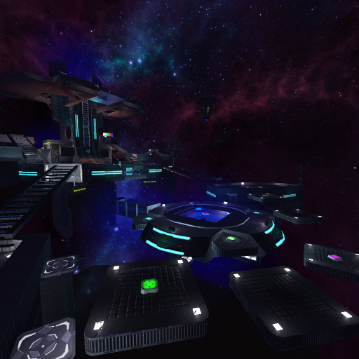

* TOC
{:toc}

## Information

| | |
|---|---|
| **Name** | Space Techno |
| **Author** | T1 and MirceaKitsune |
| **Filename** | `space` |
| **Rotation** | WIP (Work in Progress) |
| **Size** | Medium |
| **Lights** | 251 |
| **Entities** | 886 |
| **Vslots** | 126 |
| **Recommended Modes** | Deathmatch, Capture the Flag, Defend and Control, King of the Hill, Bomber Ball, Hold |

## Overview

Alien station located somewhere in deep space. Used for epic battles and playing with dark matter. Mind the low gravity and try not to fall!

## Spawn Register

| Weapon/Item | Count |
|---|:---:|
|  **Sword** | 3 |
|  **Shotgun** | 2 |
|  **SMG** | 2 |
|  **Flamer** | 2 |
|  **Plasma** | 2 |
|  **Zapper** | 2 |
|  **Rifle** | 2 |
|  **Corroder** | 2 |
|  **Grenade** | 10 |
|  **Mine** | 10 |
|  **Rocket** | 1 |
