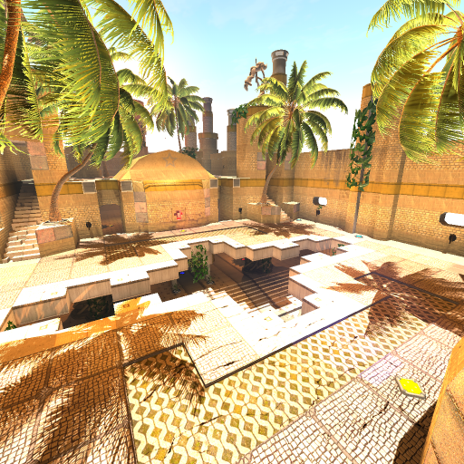

* TOC
{:toc}

## Information

| | |
|---|---|
| **Name** | Tomb |
| **Author** | Jonathan Roels (W!CK3D) and MirceaKitsune |
| **Filename** | `tomb` |
| **Rotation** | WIP (Work in Progress) |
| **Size** | Medium |
| **Lights** | 152 |
| **Entities** | 1016 |
| **Vslots** | 58 |
| **Recommended Modes** | Deathmatch, Capture the Flag, Defend and Control, King of the Hill, Bomber Ball, Hold |

## Overview

A place of warm days and magical nights, many claim to still hear the voices of those that ruled over those lands thousands of years before.

## Spawn Register

| Weapon/Item | Count |
|---|:---:|
|  **Sword** | 4 |
|  **Shotgun** | 4 |
|  **SMG** | 4 |
|  **Flamer** | 2 |
|  **Plasma** | 4 |
|  **Zapper** | 4 |
|  **Rifle** | 6 |
|  **Corroder** | 4 |
|  **Grenade** | 18 |
|  **Mine** | 14 |
|  **Rocket** | 1 |
