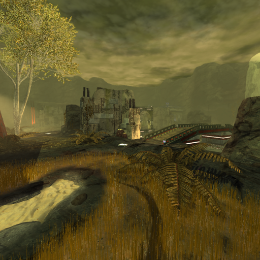

* TOC
{:toc}

## Information

| | |
|---|---|
| **Name** | Venus |
| **Author** | LuckyStrike-Rx, Jonathon 'Ulukai' De Nil and Ricky Thomson |
| **Filename** | `venus` |
| **Rotation** | Standard Rotation |
| **Size** | Medium |
| **Lights** | 126 |
| **Entities** | 866 |
| **Vslots** | 132 |
| **Recommended Modes** | Deathmatch, Capture the Flag, Defend and Control, King of the Hill, Bomber Ball, Hold, Duel |

## Overview

Once flourishing with life, venus now exists as a toxic wasteland.

## Spawn Register

| Weapon/Item | Count |
|---|:---:|
|  **Sword** | 2 |
|  **Shotgun** | 4 |
|  **SMG** | 2 |
|  **Flamer** | 2 |
|  **Plasma** | 4 |
|  **Zapper** | 2 |
|  **Rifle** | 4 |
|  **Grenade** | 6 |
|  **Mine** | 4 |
|  **Rocket** | 1 |
