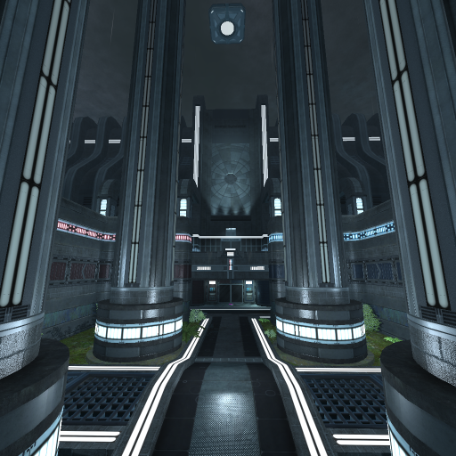

* TOC
{:toc}

## Information

| | |
|---|---|
| **Name** | Wet |
| **Author** | LuckyStrike-Rx, Unnamed and Ricky Thomson |
| **Filename** | `wet` |
| **Rotation** | Standard Rotation |
| **Size** | Medium |
| **Lights** | 128 |
| **Entities** | 844 |
| **Vslots** | 323 |
| **Recommended Modes** | Deathmatch, Capture the Flag, Defend and Control, King of the Hill, Bomber Ball, Hold, Duel |

## Overview

The great pillars are said to be harvesting energy from the storm, but many believe they are being used to create it...

## Spawn Register

| Weapon/Item | Count |
|---|:---:|
|  **Sword** | 3 |
|  **Shotgun** | 2 |
|  **SMG** | 2 |
|  **Flamer** | 2 |
|  **Plasma** | 2 |
|  **Zapper** | 4 |
|  **Rifle** | 2 |
|  **Corroder** | 2 |
|  **Grenade** | 4 |
|  **Mine** | 4 |
|  **Rocket** | 4 |
