* TOC
{:toc}
Players can [register an account](../Accounts) that allows them to authenticate as registered users. Registration is optional, so users are free to play anonymously. Some accounts have special privileges that serve for game moderation or server administration. These are indicated in-game as icons, which are shown to the left of all player names.

## Privilege Icons

| Icon                                                                         | Description          | Icon                                                                    | Description           |
|:----------------------------------------------------------------------------:|----------------------|:-----------------------------------------------------------------------:|-----------------------|
|                 | Bot (AI Controlled)  |                                                                         |                       |
|                | Guest Player         |         | Authenticated Player  |
|      | Local Supporters     |      | Global Supporters     |
|      | Local Moderators     |      | Global Moderators     |
|  | Local Administrators |  | Global Administrators |
|           | Project Developers   |        | Project Creator / Founder |

Of course, bots are not related to player accounts, but they have their own icons to readily distinguish them from human ("real") players. Some privilege levels can be either local or global. Local privileges are given to registered players on specific servers, as described in a following section. In contrast, global privileges are valid on all public servers.

Supporters are players recognised for taking part in or contributing to the project, or donating to it. By default, moderators and above can kick, ban and mute players, change server variables, pick maps and modes outside the rotation, move players between teams and to spectating, record demos, and edit maps; each of these is set by its own lock variable, so a server can move it to another level. Administrators hold every lock that moderators hold and can change the locks themselves. Developers and the founder hold all the powers of the levels below them.

## Levels and lock variables
The levels [above](#privilege-icons) sorted from low to high refer to the usage of certain server variables (`*lock`, such as `sv_varslock` or `sv_kicklock`) that define the minimum privilege required to perform a specific action (`0` = none, `1` = player, `2` = supporter, `3` = moderator, `4` = administrator, `5` = developer, `6` = founder, `7` = nobody). This allows server owners to give more liberal rights to lower player levels. The same levels can also be used to restrict map editing, joining a game, or connecting to the server. See all lock variables in the [server variables](../variables/Server#locks).

## Local Privileges
If you host a game server, you are free to specify local privileges for selected players. To add existing user accounts (including your own) to your local server user lists, in [servinit.cfg](./#configuration-files) add:
```
addlocalop <handle> <level>
```
Where level `s` is supporter, `m` is moderator, and `a` is administrator.

If you do not have an account, it is still possible to claim local administrator rights using a password specified in [servinit.cfg](./#configuration-files):
```
adminpass <password>
```
This password can be entered via the `/setpriv` command. On servers configured with an open `sv_serveropen` setting, players can also claim local moderator privileges with `/setpriv 1` if no moderator or above is present:
```
/setpriv <password>
```

Anyone with a privilege can give another player a local one on that server, from the Players panel or with `/addpriv <player> <level>`, and take it back with `/resetpriv <player>`. It has to be below your own, and so does the standing of anyone you change: a local administrator can give moderator at most. Only the server's host and founders can go further.

Bans, mutes and limits from the master server are global, and only the master's own excepts lift them. An except you add on your server protects a player from your server's entries alone.

## How to get an account
Anyone can register an account, in the game under **Player setup**, **Account**, or at https://redeclipse.net/account/register. See [Accounts](../Accounts).

Once the key is saved in your `auth.cfg`, you're identified when connecting to game servers that use accounts.
